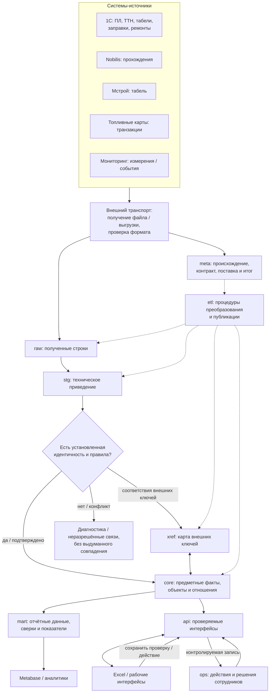

# Информационный поток DDC: девять зон ответственности

> Статус: проектная архитектура и инвентаризация **по миграциям и диагностическим материалам от 16.10.2026**. Это не живая проверка текущей production-БД. Первый фактически реализуемый набор — путевые листы 1С; другие источники не считаются подключёнными.

## 1. Цель потока

DDC должен принимать разные наборы данных, сохранять происхождение записей, приводить значения к согласованной технической форме, устанавливать общие предметные объекты и связи, хранить действия сотрудников отдельно от сведений источника и предоставлять понятные данные для поиска, сверок и аналитики.

**Единая база не означает одну общую таблицу и не превращает разные документы в один факт.** Входной документ, операция, событие мониторинга, начисленное время и результат проверки имеют разную зернистость и владельцев данных.

## 2. Карта движения информации



Это **логическая карта ответственности**, а не требование, чтобы каждый факт физически проходил девять таблиц. `etl` — операции, а не хранилище этапа. `xref` не обязателен для каждого источника. `mart` можно безопасно читать напрямую в пределах выданных прав; `api` нужен прежде всего для стабильных параметризованных интерфейсов и разрешённых изменений.

## 3. Что означает каждая схема

| Схема | Принимает | Делает | Передаёт / предоставляет |
| --- | --- | --- | --- |
| `meta` | Факты о поставщике, наборе, получении, контракте | Фиксирует техническое происхождение, область поставки, состояние обработки и результат | Контекст и управление для приёма / публикации |
| `raw` | Строки входа и адрес каждой строки в конкретной поставке | Сохраняет данные с исходным значением и установленным техническим контрактом, в пределах политики хранения | Данные для технического приведения |
| `stg` | `raw` и контракт типов | Приводит даты, числа, коды и пустые значения в рамках известного смысла | Типизированные строки с известными техническими ошибками |
| `xref` | Внешние обозначения из разных источников, подтверждённые соответствия | Сопоставляет идентификатор источника с предметным объектом; учитывает область действия и время | Разрешённые связи для `core` и процессов сопоставления |
| `core` | Типизированные данные и установленные предметные правила / соответствия | Хранит согласованные сущности, документы, операции, события и отношения; соблюдает ключи и ссылки | Предметная база для `ops`, `mart`, `api` |
| `ops` | Результаты действий сотрудников | Хранит проверки, статусы, авторство и проверенное состояние, когда оно важно | Рабочее состояние для интерфейсов и аналитики |
| `etl` | Команды обработки, данные и контракты | Управляет преобразованием, проверками, публикацией и атомарностью | Публикует допустимые результаты в соответствующие области |
| `api` | Параметры запроса или действия пользователя | Стабилизирует чтение, фильтрацию и разрешённую запись с проверкой полномочий | Рабочие выдачи и результаты операций |
| `mart` | `core`, допустимые показатели `ops` | Создаёт представления, агрегаты, сверки и метрики с известной зернистостью | BI, аналитические выборки и отчёты |

**Зона ответственности не равна физической схеме обработки.** Например, доступ к одному представлению в `mart` может использовать несколько таблиц `core`, а функция `etl` может обеспечивать несколько последовательных действий в одной транзакции.

## 4. Два самостоятельных движения

### A. Входящие данные

1. Получить набор от конкретного источника; проверить структуру и техническую целостность до публикации.
2. Зафиксировать технический контекст поставки и сами записи по договорённому контракту (`meta` / `raw`).
3. Привести значения без самостоятельного изменения предметного смысла (`stg`).
4. Найти известные предметные ключи; там, где необходимо, разрешить внешние обозначения через `xref`.
5. Провести предметные проверки и опубликовать объекты/события в `core` атомарно.
6. Сформировать `mart` и/или `api` для пользователей.

Нельзя превращать частичную поставку в полный снимок. Неудачная публикация не должна оставлять наполовину заменённый `core`. Способ сохранения неразрешённых строк определяется контрактом конкретного набора; это не требование создавать заранее универсальный «карантин».

### B. Действия сотрудника и обратная связь

1. Интерфейс получает **пул документов или других объектов** с уже известными результатами проверок (`api` и/или разрешённый `mart`).
2. Сотрудник выполняет сверку и передаёт действие по контролируемому интерфейсу.
3. `api` проверяет полномочия и актуальность проверяемого состояния; результат записывается в `ops`.
4. Следующая выдача показывает существующий результат и признаки того, к какому состоянию он относится.
5. Новая поставка данных в `core` не должна тихо превращать старый результат `ops` в подтверждение исправленного документа.

Действие сотрудника нельзя переписать очередным снимком исходной системы без самостоятельного правила рабочего процесса.

## 5. Подтверждённая область: путевые листы 1С

### По имеющимся SQL-миграциям и диагностике

| Область | Наблюдаемая реализация на 16.10.2026 | Статус уверенности |
| --- | --- | --- |
| `meta` | `meta.waybill_scope` используется для координации месячного снимка; **полного реестра источников и поставок не показано** | Реализован узкий механизм |
| `raw` | `raw.waybill_record`, технический `load_id`, исходные текстовые значения и номер строки | Реализовано для ПЛ |
| `stg` | `stg.waybill_record` — типизированное представление | Реализовано для ПЛ |
| `xref` | Соответствия между несколькими источниками в подтверждённом наборе миграций не найдены | Не реализовано для межисточниковой интеграции |
| `core` | `waybill`, `waybill_driver`, `waybill_task`, `waybill_idle`, `waybill_fuel` | Структура и загрузка реализованы; корректность предметных трактовок проверяется |
| `ops` | Существует отдельный **кандидат** `010_ops_waybill_check_candidate.sql`; факт применения в production не подтверждён | Не считать внедрённым |
| `etl` | `etl.prepare_waybill()`, `etl.load_waybill()`, транзакционная публикация снимка | Реализовано для ПЛ |
| `api` | В кандидатной 010: `api.waybill_check_pool`, `api.save_waybill_check(...)`; факт внедрения не подтверждён | Не считать внедрённым |
| `mart` | `mart.waybill` и четыре детальных представления | Реализовано; аналитические значения ещё требуют приёмки |

Указанные факты относятся к **доступным миграциям 001–009 и отдельной 010-кандидату**, а не к live-инвентаризации. В диагностике доступа от 16.10 `api` ещё отсутствовала.

### Путь одной выгрузки путевых в существующей реализации

```text
1С: месячная выгрузка
  -> вне БД: проверка формата и транспортное приведение CSV/TXT -> TSV
  -> etl.prepare_waybill() + временный ввод
  -> etl.load_waybill()
       -> raw.waybill_record
       -> stg.waybill_record
       -> проверка границ месячного снимка
       -> meta.waybill_scope (координация)
       -> core.waybill + driver/task/idle/fuel
       -> сохранение принятого текущего RAW по политике реализации
  -> mart.waybill / mart.waybill_* 
  -> Excel / BI (при наличии соответствующих доступов)
```

Физический порядок отдельных проверок и блокировок определяется кодом функций, а не данной упрощённой схемой. `raw` в текущей реализации хранит не обязательно все исторические версии поставок: политика сохранения снапшотов требует отдельной оценки воспроизводимости.

### Что не даёт объявить модуль завершённым

- Не проверен весь жизненный цикл «получил — проверил — сохранил результат — увидел его после обновления ПЛ».
- Не подтверждено, что кандидатная 010 отвечает реальной необходимости видеть прежние проверки и отличать бумажные экземпляры. Она хранит **одно текущее** состояние проверки на ключ ПЛ, а не автоматически полную историю.
- В диагностических материалах обнаружены случаи интерпретации продолжительности работ (в том числе текстовые записи вида `3,40`) и нетривиальные топливные строки; требуется принять предметные правила, а не молча переинтерпретировать значения.
- Контракты для ТТН, табелей, заправок, ремонтов, топливных карт, мониторинга и прохождений ещё не представлены в проверенных схемах загрузки.

## 6. Как подключать следующие наборы

Для каждого набора составить краткий *контракт потока*:

| Вопрос | Что фиксируем |
| --- | --- |
| Откуда и что приходит? | Поставщик, имя набора, способ и периодичность поставки |
| Что означает запись? | Документ, строка документа, событие, транзакция, измерение либо интервал |
| Как узнаём ту же запись? | Внешний ключ, область его действия, исправления и повторы |
| Как меняется информация? | Полный снимок, дополнение, исправление, отмена |
| К чему относится запись? | ТС, работник, подразделение, карта, устройство, операция |
| Как подтверждается связь? | Правила сопоставления, `xref`, неоднозначность и период действия |
| Куда публикуем? | Предметная область `core` и/или отдельные действия `ops` |
| Кто и как использует? | Выдачи `api`, представления `mart`, функции пользователя |
| Как проверяем? | Контроль объёма, исключения, ошибки, сверки с источником, восстановление |

**Пример:** топливная карта не становится ТС. Карта может быть закреплена за разными ТС в разные периоды; только подтверждённое соответствие допускает приписывание транзакции машине. Мониторинговое устройство — тоже отдельный объект, а его показания — отдельные события или измерения.

## 7. Следующий шаг: независимая проверка текущей базы

Перед изменением схем и разработкой новых загрузок выполнить только чтение:

1. Проверить, какие из девяти схем реально существуют и какие объекты в них размещены.
2. Проверить установленные роли, их доступы, функции, представления и существующие миграции.
3. Зафиксировать контракт входного файла путевых и весь фактический маршрут от TSV до `mart`.
4. Воспроизвести контроль агрегатов и семантики длительности/ГСМ; отдельно проверить полные месячные снимки, сбои и повторную публикацию.
5. Установить, применялась ли кандидатная 010; не менять `ops` до решения, нужна ли история проверок.
6. Только после этого принять первый контракт новой поставки и оценить потребность в `xref` и общей модели транспорта.

Доказательство готовности должно опираться на воспроизводимый результат работающей системы, а не на факт наличия SQL-файла.

## Связанные документы

- [Назначение DDC](01-purpose-and-boundaries.md)
- [Интеграция источников и девять границ](06-source-integration.md)
- [Карта источников](07-source-catalog.md)
- [План развития](04-roadmap.md)

## 8. Первая безопасная инвентаризация PostgreSQL

Запрос не меняет данные и показывает **фактическое наличие схем и объектов** в той базе, к которой подключился оператор. Наличие объекта само по себе не доказывает готовность рабочего процесса.

```sql
WITH wanted(schema_name) AS (
    VALUES ('meta'), ('raw'), ('stg'), ('xref'), ('core'),
           ('ops'), ('etl'), ('api'), ('mart')
),
relations AS (
    SELECT n.nspname,
           count(*) FILTER (WHERE c.relkind IN ('r', 'p')) AS tables,
           count(*) FILTER (WHERE c.relkind = 'v') AS views,
           count(*) FILTER (WHERE c.relkind = 'm') AS materialized_views
    FROM pg_catalog.pg_namespace AS n
    LEFT JOIN pg_catalog.pg_class AS c ON c.relnamespace = n.oid
    GROUP BY n.nspname
),
routines AS (
    SELECT n.nspname, count(*) AS functions_and_procedures
    FROM pg_catalog.pg_proc AS p
    JOIN pg_catalog.pg_namespace AS n ON n.oid = p.pronamespace
    GROUP BY n.nspname
)
SELECT w.schema_name,
       CASE WHEN n.oid IS NULL THEN 'ABSENT' ELSE 'PRESENT' END AS schema_status,
       coalesce(r.tables, 0) AS tables,
       coalesce(r.views, 0) AS views,
       coalesce(r.materialized_views, 0) AS materialized_views,
       coalesce(f.functions_and_procedures, 0) AS routines
FROM wanted AS w
LEFT JOIN pg_catalog.pg_namespace AS n ON n.nspname = w.schema_name
LEFT JOIN relations AS r ON r.nspname = w.schema_name
LEFT JOIN routines AS f ON f.nspname = w.schema_name
ORDER BY w.schema_name;
```

Контрольное наличие основных объектов путевых:

```sql
SELECT current_database() AS db,
       current_setting('server_version') AS pg_version,
       to_regclass('meta.waybill_scope') AS month_scope,
       to_regclass('raw.waybill_record') AS raw_records,
       to_regclass('stg.waybill_record') AS typed_records,
       to_regclass('core.waybill') AS subject_waybill,
       to_regclass('mart.waybill') AS analytical_waybill,
       to_regclass('ops.waybill_check') AS paper_check,
       to_regclass('api.waybill_check_pool') AS check_pool,
       to_regprocedure('etl.prepare_waybill()') AS prepare_function,
       to_regprocedure('etl.load_waybill()') AS publication_function;
```

Если в `ops` или `api` появится объект, следующий этап — проверить его DDL, права и фактический пользовательский сценарий. Нельзя считать ветку `010` применённой только по наличию файла в архиве. Для проверки текущих расчётов потребуются отдельные выборки по данным, без каких-либо изменений.
