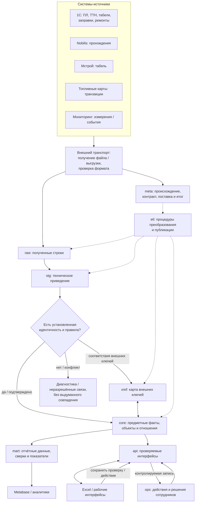

# Информационный поток DDC: девять зон ответственности

> Статус: проектная архитектура и инвентаризация **по миграциям и диагностическим материалам от 16.10.2026**. Это не живая проверка текущей production-БД. Первый фактически реализуемый набор — путевые листы 1С; другие источники не считаются подключёнными.

## 1. Цель потока

DDC должен принимать разные наборы данных, сохранять происхождение записей, приводить значения к согласованной технической форме, устанавливать общие предметные объекты и связи, хранить действия сотрудников отдельно от сведений источника и предоставлять понятные данные для поиска, сверок и аналитики.

**Единая база не означает одну общую таблицу и не превращает разные документы в один факт.** Входной документ, операция, событие мониторинга, начисленное время и результат проверки имеют разную зернистость и владельцев данных.

## 2. Карта движения информации



Это **логическая карта ответственности**, а не требование, чтобы каждый факт физически проходил девять таблиц. `etl` — операции, а не хранилище этапа. `xref` не обязателен для каждого источника. `mart` можно безопасно читать напрямую в пределах выданных прав; `api` нужен прежде всего для стабильных параметризованных интерфейсов и разрешённых изменений.

## 3. Что означает каждая схема

| Схема | Принимает | Делает | Передаёт / предоставляет |
| --- | --- | --- | --- |
| `meta` | Факты о поставщике, наборе, получении, контракте | Фиксирует техническое происхождение, область поставки, состояние обработки и результат | Контекст и управление для приёма / публикации |
| `raw` | Строки входа и адрес каждой строки в конкретной поставке | Сохраняет данные с исходным значением и установленным техническим контрактом, в пределах политики хранения | Данные для технического приведения |
| `stg` | `raw` и контракт типов | Приводит даты, числа, коды и пустые значения в рамках известного смысла | Типизированные строки с известными техническими ошибками |
| `xref` | Внешние обозначения из разных источников, подтверждённые соответствия | Сопоставляет идентификатор источника с предметным объектом; учитывает область действия и время | Разрешённые связи для `core` и процессов сопоставления |
| `core` | Типизированные данные и установленные предметные правила / соответствия | Хранит согласованные сущности, документы, операции, события и отношения; соблюдает ключи и ссылки | Предметная база для `ops`, `mart`, `api` |
| `ops` | Результаты действий сотрудников | Хранит проверки, статусы, авторство и проверенное состояние, когда оно важно | Рабочее состояние для интерфейсов и аналитики |
| `etl` | Команды обработки, данные и контракты | Управляет преобразованием, проверками, публикацией и атомарностью | Публикует допустимые результаты в соответствующие области |
| `api` | Параметры запроса или действия пользователя | Стабилизирует чтение, фильтрацию и разрешённую запись с проверкой полномочий | Рабочие выдачи и результаты операций |
| `mart` | `core`, допустимые показатели `ops` | Создаёт представления, агрегаты, сверки и метрики с известной зернистостью | BI, аналитические выборки и отчёты |

**Зона ответственности не равна физической схеме обработки.** Например, доступ к одному представлению в `mart` может использовать несколько таблиц `core`, а функция `etl` может обеспечивать несколько последовательных действий в одной транзакции.

## 4. Два самостоятельных движения

### A. Входящие данные

1. Получить набор от конкретного источника; проверить структуру и техническую целостность до публикации.
2. Зафиксировать технический контекст поставки и сами записи по договорённому контракту (`meta` / `raw`).
3. Привести значения без самостоятельного изменения предметного смысла (`stg`).
4. Найти известные предметные ключи; там, где необходимо, разрешить внешние обозначения через `xref`.
5. Провести предметные проверки и опубликовать объекты/события в `core` атомарно.
6. Сформировать `mart` и/или `api` для пользователей.

Нельзя превращать частичную поставку в полный снимок. Неудачная публикация не должна оставлять наполовину заменённый `core`. Способ сохранения неразрешённых строк определяется контрактом конкретного набора; это не требование создавать заранее универсальный «карантин».

### B. Действия сотрудника и обратная связь

1. Интерфейс получает **пул документов или других объектов** с уже известными результатами проверок (`api` и/или разрешённый `mart`).
2. Сотрудник выполняет сверку и передаёт действие по контролируемому интерфейсу.
3. `api` проверяет полномочия и актуальность проверяемого состояния; результат записывается в `ops`.
4. Следующая выдача показывает существующий результат и признаки того, к какому состоянию он относится.
5. Новая поставка данных в `core` не должна тихо превращать старый результат `ops` в подтверждение исправленного документа.

Действие сотрудника нельзя переписать очередным снимком исходной системы без самостоятельного правила рабочего процесса.

## 5. Подтверждённая область: путевые листы 1С

### По имеющимся SQL-миграциям и диагностике

| Область | Наблюдаемая реализация на 16.10.2026 | Статус уверенности |
| --- | --- | --- |
| `meta` | `meta.waybill_scope` используется для координации месячного снимка; **полного реестра источников и поставок не показано** | Реализован узкий механизм |
| `raw` | `raw.waybill_record`, технический `load_id`, исходные текстовые значения и номер строки | Реализовано для ПЛ |
| `stg` | `stg.waybill_record` — типизированное представление | Реализовано для ПЛ |
| `xref` | Соответствия между несколькими источниками в подтверждённом наборе миграций не найдены | Не реализовано для межисточниковой интеграции |
| `core` | `waybill`, `waybill_driver`, `waybill_task`, `waybill_idle`, `waybill_fuel` | Структура и загрузка реализованы; корректность предметных трактовок проверяется |
| `ops` | Существует отдельный **кандидат** `010_ops_waybill_check_candidate.sql`; факт применения в production не подтверждён | Не считать внедрённым |
| `etl` | `etl.prepare_waybill()`, `etl.load_waybill()`, транзакционная публикация снимка | Реализовано для ПЛ |
| `api` | В кандидатной 010: `api.waybill_check_pool`, `api.save_waybill_check(...)`; факт внедрения не подтверждён | Не считать внедрённым |
| `mart` | `mart.waybill` и четыре детальных представления | Реализовано; аналитические значения ещё требуют приёмки |

Указанные факты относятся к **доступным миграциям 001–009 и отдельной 010-кандидату**, а не к live-инвентаризации. В диагностике доступа от 16.10 `api` ещё отсутствовала.

### Путь одной выгрузки путевых в существующей реализации

```text
1С: месячная выгрузка
  -> вне БД: проверка формата и транспортное приведение CSV/TXT -> TSV
  -> etl.prepare_waybill() + временный ввод
  -> etl.load_waybill()
       -> raw.waybill_record
       -> stg.waybill_record
       -> проверка границ месячного снимка
       -> meta.waybill_scope (координация)
       -> core.waybill + driver/task/idle/fuel
       -> сохранение принятого текущего RAW по политике реализации
  -> mart.waybill / mart.waybill_* 
  -> Excel / BI (при наличии соответствующих доступов)
```

Физический порядок отдельных проверок и блокировок определяется кодом функций, а не данной упрощённой схемой. `raw` в текущей реализации хранит не обязательно все исторические версии поставок: политика сохранения снапшотов требует отдельной оценки воспроизводимости.

### Что не даёт объявить модуль завершённым

- Не проверен весь жизненный цикл «получил — проверил — сохранил результат — увидел его после обновления ПЛ».
- Не подтверждено, что кандидатная 010 отвечает реальной необходимости видеть прежние проверки и отличать бумажные экземпляры. Она хранит **одно текущее** состояние проверки на ключ ПЛ, а не автоматически полную историю.
- В диагностических материалах обнаружены случаи интерпретации продолжительности работ (в том числе текстовые записи вида `3,40`) и нетривиальные топливные строки; требуется принять предметные правила, а не молча переинтерпретировать значения.
- Контракты для ТТН, табелей, заправок, ремонтов, топливных карт, мониторинга и прохождений ещё не представлены в проверенных схемах загрузки.

## 6. Как подключать следующие наборы

Для каждого набора составить краткий *контракт потока*:

| Вопрос | Что фиксируем |
| --- | --- |
| Откуда и что приходит? | Поставщик, имя набора, способ и периодичность поставки |
| Что означает запись? | Документ, строка документа, событие, транзакция, измерение либо интервал |
| Как узнаём ту же запись? | Внешний ключ, область его действия, исправления и повторы |
| Как меняется информация? | Полный снимок, дополнение, исправление, отмена |
| К чему относится запись? | ТС, работник, подразделение, карта, устройство, операция |
| Как подтверждается связь? | Правила сопоставления, `xref`, неоднозначность и период действия |
| Куда публикуем? | Предметная область `core` и/или отдельные действия `ops` |
| Кто и как использует? | Выдачи `api`, представления `mart`, функции пользователя |
| Как проверяем? | Контроль объёма, исключения, ошибки, сверки с источником, восстановление |

**Пример:** топливная карта не становится ТС. Карта может быть закреплена за разными ТС в разные периоды; только подтверждённое соответствие допускает приписывание транзакции машине. Мониторинговое устройство — тоже отдельный объект, а его показания — отдельные события или измерения.

## 7. Следующий шаг: независимая проверка текущей базы

Перед изменением схем и разработкой новых загрузок выполнить только чтение:

1. Проверить, какие из девяти схем реально существуют и какие объекты в них размещены.
2. Проверить установленные роли, их доступы, функции, представления и существующие миграции.
3. Зафиксировать контракт входного файла путевых и весь фактический маршрут от TSV до `mart`.
4. Воспроизвести контроль агрегатов и семантики длительности/ГСМ; отдельно проверить полные месячные снимки, сбои и повторную публикацию.
5. Установить, применялась ли кандидатная 010; не менять `ops` до решения, нужна ли история проверок.
6. Только после этого принять первый контракт новой поставки и оценить потребность в `xref` и общей модели транспорта.

Доказательство готовности должно опираться на воспроизводимый результат работающей системы, а не на факт наличия SQL-файла.

## Связанные документы

- [Назначение DDC](01-purpose-and-boundaries.md)
- [Интеграция источников и девять границ](06-source-integration.md)
- [Карта источников](07-source-catalog.md)
- [План развития](04-roadmap.md)

## 8. Первая безопасная инвентаризация PostgreSQL

Запрос не меняет данные и показывает **фактическое наличие схем и объектов** в той базе, к которой подключился оператор. Наличие объекта само по себе не доказывает готовность рабочего процесса.

```sql
WITH wanted(schema_name) AS (
    VALUES ('meta'), ('raw'), ('stg'), ('xref'), ('core'),
           ('ops'), ('etl'), ('api'), ('mart')
),
relations AS (
    SELECT n.nspname,
           count(*) FILTER (WHERE c.relkind IN ('r', 'p')) AS tables,
           count(*) FILTER (WHERE c.relkind = 'v') AS views,
           count(*) FILTER (WHERE c.relkind = 'm') AS materialized_views
    FROM pg_catalog.pg_namespace AS n
    LEFT JOIN pg_catalog.pg_class AS c ON c.relnamespace = n.oid
    GROUP BY n.nspname
),
routines AS (
    SELECT n.nspname, count(*) AS functions_and_procedures
    FROM pg_catalog.pg_proc AS p
    JOIN pg_catalog.pg_namespace AS n ON n.oid = p.pronamespace
    GROUP BY n.nspname
)
SELECT w.schema_name,
       CASE WHEN n.oid IS NULL THEN 'ABSENT' ELSE 'PRESENT' END AS schema_status,
       coalesce(r.tables, 0) AS tables,
       coalesce(r.views, 0) AS views,
       coalesce(r.materialized_views, 0) AS materialized_views,
       coalesce(f.functions_and_procedures, 0) AS routines
FROM wanted AS w
LEFT JOIN pg_catalog.pg_namespace AS n ON n.nspname = w.schema_name
LEFT JOIN relations AS r ON r.nspname = w.schema_name
LEFT JOIN routines AS f ON f.nspname = w.schema_name
ORDER BY w.schema_name;
```

Контрольное наличие основных объектов путевых:

```sql
SELECT current_database() AS db,
       current_setting('server_version') AS pg_version,
       to_regclass('meta.waybill_scope') AS month_scope,
       to_regclass('raw.waybill_record') AS raw_records,
       to_regclass('stg.waybill_record') AS typed_records,
       to_regclass('core.waybill') AS subject_waybill,
       to_regclass('mart.waybill') AS analytical_waybill,
       to_regclass('ops.waybill_check') AS paper_check,
       to_regclass('api.waybill_check_pool') AS check_pool,
       to_regprocedure('etl.prepare_waybill()') AS prepare_function,
       to_regprocedure('etl.load_waybill()') AS publication_function;
```

Если в `ops` или `api` появится объект, следующий этап — проверить его DDL, права и фактический пользовательский сценарий. Нельзя считать ветку `010` применённой только по наличию файла в архиве. Для проверки текущих расчётов потребуются отдельные выборки по данным, без каких-либо изменений.

## 9. Результат инвентаризации 19.10.2026 — сообщение оператора

**Источник свидетельства:** два вывода read-only запросов из §8, выполненных оператором в базе `ddc`. Проверка подтверждает только состав схем, количество объектов указанных типов и разрешение названных объектов в каталогах PostgreSQL на момент исполнения. Независимое повторение запроса автором документа не выполнялось.

### RAW RESULT

```text
api    ABSENT   0 0 0 0
core   PRESENT  5 0 0 0
etl    PRESENT  0 0 0 2
mart   PRESENT  0 5 0 0
meta   PRESENT  1 0 0 0
ops    ABSENT   0 0 0 0
raw    PRESENT  1 0 0 0
stg    PRESENT  0 1 0 0
xref   ABSENT   0 0 0 0

db=ddc
server_version=18.6 (Ubuntu 18.6-1.pgdg26.04+2)
month_scope=meta.waybill_scope
raw_records=raw.waybill_record
typed_records=stg.waybill_record
subject_waybill=core.waybill
analytical_waybill=mart.waybill
paper_check=NULL
check_pool=NULL
prepare_function=etl.prepare_waybill()
publication_function=etl.load_waybill()
```

Колонки первой матрицы: имя схемы, наличие, число таблиц, обычных представлений, материализованных представлений и функций/процедур. `NULL` во второй матрице означает отсутствие разрешённого имени объекта.

### Вердикты с границами

| Утверждение | Свидетельство | Статус |
| --- | --- | --- |
| В текущей базе существуют `meta`, `raw`, `stg`, `core`, `etl`, `mart` | Показания `pg_catalog` в выполненной оператором инвентаризации | MEASURED, по предоставленному выводу |
| Схемы `xref`, `ops`, `api` в обследованной базе отсутствуют | Те же показания | MEASURED, по предоставленному выводу |
| Известные таблицы/представления путевых и две функции `etl` существуют | `to_regclass`, `to_regprocedure` вернули имена | MEASURED, по предоставленному выводу |
| Данные путевых полны, значения корректны, механизмы публикации безопасны | Инвентаризация это не проверяла | NOT VERIFIED |
| Кандидатная миграция `010` внедрена | `ops` и `api` отсутствуют | Опровергнуто в пределах обследованной базы |
| Другие источники уже интегрированы | Ни каталог, ни данные этих источников не проверялись | NOT VERIFIED |

**Решение:** не создавать сейчас недостающие три схемы только ради заполнения архитектуры. Сначала завершить предметную проверку потока путевых и контракты новых источников. Кандидатную `010` не относить к установленной production-структуре.

### Следующая проверка: наполненность потока

Следующий запрос только читает данные и показывает объём текущих отношений, число сохранённых технических поступлений и соответствие зернистости основного `mart` и `core`. Наличие равных чисел — **не доказательство правильности значений**.

```sql
BEGIN TRANSACTION ISOLATION LEVEL REPEATABLE READ, READ ONLY;

SELECT 'raw.waybill_record' AS relation_name, count(*) AS rows_count
FROM raw.waybill_record
UNION ALL SELECT 'core.waybill', count(*) FROM core.waybill
UNION ALL SELECT 'core.waybill_driver', count(*) FROM core.waybill_driver
UNION ALL SELECT 'core.waybill_task', count(*) FROM core.waybill_task
UNION ALL SELECT 'core.waybill_idle', count(*) FROM core.waybill_idle
UNION ALL SELECT 'core.waybill_fuel', count(*) FROM core.waybill_fuel
UNION ALL SELECT 'mart.waybill', count(*) FROM mart.waybill
ORDER BY relation_name;

SELECT count(DISTINCT load_id) AS retained_raw_load_tokens
FROM raw.waybill_record;

SELECT
    (SELECT count(*) FROM core.waybill) AS core_count,
    (SELECT count(*) FROM mart.waybill) AS mart_count,
    (
        SELECT count(*)
        FROM (
            SELECT numbering_year, waybill_number
            FROM mart.waybill
            GROUP BY numbering_year, waybill_number
            HAVING count(*) > 1
        ) AS duplicate_keys
    ) AS duplicate_mart_keys;

COMMIT;
```

Это диагностический SQL, не миграция и не изменение структуры. Проверка может выполнить полное чтение нескольких больших таблиц, поэтому запускать в допустимое окно нагрузки.

## 10. Наполненность контура путевых — наблюдение оператора

**Источник:** предоставленные оператором результаты read-only запросов, база `ddc`. Дата фиксации: 19.10.2026; точное время исполнения SQL не сообщалось. Независимый запуск в production автором документа не выполнялся.

### RAW RESULT

| Отношение | Количество строк |
| --- | ---: |
| `raw.waybill_record` | 1 186 296 |
| `core.waybill` | 792 850 |
| `core.waybill_driver` | 807 445 |
| `core.waybill_task` | 799 684 |
| `core.waybill_idle` | 748 664 |
| `core.waybill_fuel` | 824 290 |
| `mart.waybill` | 792 850 |

По отдельному запросу `mart_rows = 792850` и `distinct_waybills = 792850`, где уникальность считалась для составной пары `(numbering_year, waybill_number)`.

Значение `retained_load_tokens` в присланном сообщении не выделено однозначно, поэтому **NOT VERIFIED**. Нельзя приписывать ему значение на основании старых проверок.

### CLAIM / EVIDENCE / LIMITATIONS / DECISION

- **CLAIM:** основное `mart.waybill` не дублирует пары `(numbering_year, waybill_number)` в обследованном состоянии.
- **EVIDENCE:** совпадение `mart_rows` и `distinct_waybills` на 792 850 строках.
- **FALSIFIER:** наличие двух или более строк с одной парой ключевых значений либо несовпадение составов ключей CORE и MART.
- **TEST:** агрегат `count(*)`, `count(DISTINCT (numbering_year, waybill_number))`; сравнение полных множеств ключей ещё не выполнялось.
- **RAW RESULT:** 792 850 / 792 850.
- **STATUS:** MEASURED на представленном состоянии.
- **LIMITATIONS:** не подтверждены совпадение множеств ключей, правильность значений, сумма ГСМ, семантика длительности, границы снимков или результат рабочего процесса.
- **DECISION:** принять отсутствие размножения по ключу для обследованной выборки; остальные инварианты оставить NOT VERIFIED.

### Следующая проверка: от технических строк к предметным ключам

Если в RAW действительно удерживаются только текущие принятые месячные снимки, ожидается совпадение множеств ключей из типизированных строк STG и CORE. Это ожидание **условно**: оно может быть неверно при иной политике удержания RAW, исключённых записях или преобразованиях бизнес-ключей. Расхождение сначала расследуется, а не исправляется через `DISTINCT`/замену ключей.

```sql
BEGIN TRANSACTION ISOLATION LEVEL REPEATABLE READ, READ ONLY;

SELECT load_id, count(*) AS source_rows,
       count(DISTINCT date_trunc('month', waybill_at)::date) AS business_months,
       min(waybill_at)::date AS first_document_date,
       max(waybill_at)::date AS last_document_date
FROM stg.waybill_record
GROUP BY load_id
ORDER BY load_id;

WITH source_keys AS MATERIALIZED (
    SELECT DISTINCT extract(year FROM waybill_at)::integer AS numbering_year,
                    waybill_number
    FROM stg.waybill_record
    WHERE waybill_at IS NOT NULL AND waybill_number IS NOT NULL
)
SELECT
    (SELECT count(*) FROM (
        SELECT numbering_year, waybill_number FROM source_keys
        EXCEPT
        SELECT numbering_year, waybill_number FROM core.waybill
    ) AS missing) AS source_only_keys,
    (SELECT count(*) FROM (
        SELECT numbering_year, waybill_number FROM core.waybill
        EXCEPT
        SELECT numbering_year, waybill_number FROM source_keys
    ) AS missing) AS core_only_keys;

COMMIT;
```

Для крупной базы это полные проходы по источнику и может быть ресурсоёмко; выполнять в согласованное время. `MATERIALIZED` здесь фиксирует одно вычисление диагностического набора в рамках запроса и **не является** предложением создать production materialized view.

## 11. STG ↔ CORE: равенство множества ключей

**Полученный результат 19.10.2026:** оператор выполнил диагностическое сравнение множеств ключей из §10.

```text
source_only_keys | core_only_keys
-----------------+---------------
               0 |              0
```

**CLAIM:** множества `(extract(year from waybill_at)::integer, waybill_number)` в сохранённой типизированной STG и `(numbering_year, waybill_number)` в CORE совпадают.

**EVIDENCE:** обе разности множеств `EXCEPT` равны нулю.

**FALSIFIER:** хотя бы один ключ встречается только по одну сторону сравнения.

**TEST:** read-only SQL из §10, `EXCEPT` в обе стороны по двум ключевым атрибутам.

**RAW RESULT:** `source_only_keys=0`, `core_only_keys=0`.

**STATUS:** MEASURED на обследованном состоянии, по предоставленному выводу; повторный независимый запуск не выполнялся.

**LIMITATIONS:** из STG исключались записи с `waybill_at IS NULL` или `waybill_number IS NULL`; их количество здесь не измерено. `DISTINCT` сравнивает множество пар, а не число физических строк. Не проверялись предметная устойчивость ключа, равенство атрибутов, детальные записи водителей/работ/простоев/ГСМ, семантика обновления и полнота месячных поставок. Результат первого запроса по `load_id` из §10 оператор не передал.

**DECISION:** для существующих ненулевых пар не обнаружено потерянных или лишних ключей в CORE. До изучения полноты исходных строк и сравнения значений остальные выводы остаются NOT VERIFIED.

### Следующий тест — фактическое содержание заголовка ПЛ

Проверить `NULL`-ключи и полный набор предметных атрибутов заголовка из STG и CORE. Сравнение выполняется по совпадающему контракту полей миграций 002/004/006; в отношении гаражного номера имена различаются (`vehicle_garage_number` в STG и `garage_number` в CORE).

```sql
BEGIN TRANSACTION ISOLATION LEVEL REPEATABLE READ, READ ONLY;

SELECT
  count(*) AS stg_rows,
  count(*) FILTER (WHERE waybill_at IS NULL OR waybill_number IS NULL)
    AS rows_with_incomplete_key
FROM stg.waybill_record;

WITH source_headers AS MATERIALIZED (
  SELECT DISTINCT
    extract(year FROM waybill_at)::integer AS numbering_year,
    waybill_number, waybill_at, is_calculated, departure_at, return_at,
    organization_name, department_name, waybill_type, vehicle_work_mode,
    departure_meter, return_meter, note, responsible_name,
    vehicle_type, vehicle_make, vehicle_model, vehicle_vin,
    vehicle_garage_number AS garage_number, vehicle_plate
  FROM stg.waybill_record
  WHERE waybill_at IS NOT NULL AND waybill_number IS NOT NULL
), core_headers AS MATERIALIZED (
  SELECT numbering_year, waybill_number, waybill_at, is_calculated,
    departure_at, return_at, organization_name, department_name,
    waybill_type, vehicle_work_mode, departure_meter, return_meter,
    note, responsible_name, vehicle_type, vehicle_make, vehicle_model,
    vehicle_vin, garage_number, vehicle_plate
  FROM core.waybill
)
SELECT
  (SELECT count(*) FROM (
    SELECT * FROM source_headers
    EXCEPT SELECT * FROM core_headers
  ) AS d) AS stg_only_header_variants,
  (SELECT count(*) FROM (
    SELECT * FROM core_headers
    EXCEPT SELECT * FROM source_headers
  ) AS d) AS core_only_header_variants;

COMMIT;
```

Ожидаемые нули — лишь проверяемая гипотеза. Даже при нулях полностью совпавшие заголовки не докажут правильность числовой семантики или остальных дочерних фактов. Запросы читают крупные наборы данных.

## 12. Сопоставление заголовков STG ↔ CORE — наблюдение оператора

**Источник:** результат read-only сравнения полных заголовков `source_headers EXCEPT core_headers` и наоборот из §11. Дата фиксации: 19.10.2026. Результат по `rows_with_incomplete_key` не представлен.

```text
stg_only_header_variants | core_only_header_variants
-------------------------+--------------------------
                       0 |                         0
```

**CLAIM:** множества 20-атрибутных типизированных заголовков (после `SELECT DISTINCT` и исключения строк с пустой парой ключевых значений) совпадают между STG и CORE.

**EVIDENCE:** две разности полных кортежей `EXCEPT` равны нулю.

**FALSIFIER:** одна различающаяся комбинация ключа или атрибутов, попадающая только в одну сторону сравнения.

**TEST:** двухстороннее сравнение `EXCEPT` по всем 20 атрибутам с приведением имени `vehicle_garage_number` STG к `garage_number` CORE.

**RAW RESULT:** `0 | 0`.

**STATUS:** MEASURED на представленном состоянии базы; повторный независимый запуск не выполнялся.

**LIMITATIONS:** физические строки STG с `NULL` в `waybill_at` или `waybill_number` исключены; их количество пока NOT VERIFIED. Смысл преобразований в STG и правильность предметных значений не проверены. Не подтверждено совпадение дочерних фактов (водители, работы, простои, ГСМ). Это не проверка полноты или порядка месячных поставок.

**DECISION:** допустить вывод о совпадении множества типизированных заголовков с заголовками CORE на обследованной population. Другие выводы — NONE.

### Отдельное предупреждение о длительности

В ранее сохранённой диагностике `ddc_task_duration_hhmm_probe.out` от 16.10.2026: `task_rows=799684`, `valid_hhmm_encoding=799684`, `decimal_matches_1_second=798820`, `hhmm_matches_1_second=798860`, `decimal_disagrees_but_hhmm_matches=37`, `hhmm_disagrees_1_second=1`. Эти измерения показывают возможную ошибку интерпретации дробной части длительности: в STG дробная запятая сейчас приводится как десятичное число, а образцы `3,40` согласуются с форматом «3 часа 40 минут». **Предметный контракт ещё НЕ VERIFIED; исправлять единицы до его подтверждения нельзя.**

### Следующая проверка

Проверить `NULL`-ключи и двустороннее совпадение всех фактов ГСМ между STG и CORE, затем остальных дочерних отношений. Совпадение само по себе не подтверждает формулу расхода топлива в MART.

## 13. Проверка строк ГСМ STG ↔ CORE — наблюдение оператора

**Источник:** результат read-only запроса, предоставленный оператором. Дата фиксации: 19.10.2026; независимого выполнения в production не было.

### RAW RESULT

```text
source_fuel_rows | core_fuel_rows | stg_only_fuel | core_only_fuel
-----------------+----------------+---------------+---------------
          824290 |         824290 |             0 |             0
```

**CLAIM:** множества уникальных кортежей (год, номер ПЛ, номер строки ГСМ, начальный/конечный остатки, название топлива, заправлено, слито) в сохранённой STG и CORE совпадают.

**EVIDENCE:** двусторонний `EXCEPT` по восьми атрибутам вернул 0 и 0; обе стороны содержат по 824 290 сравниваемых строк после `DISTINCT` на стороне STG.

**FALSIFIER:** кортеж, встречающийся только в одном отношении, либо различие значений поля при том же установленном ключе.

**TEST:** read-only диагностический SQL с `SELECT DISTINCT` по STG, `EXCEPT` в обе стороны и `count(*)` обеих выборок.

**STATUS:** MEASURED по предоставленному выводу, на обследованном состоянии.

**LIMITATIONS:** исходная физическая кратность строк STG не проверялась (применялся `DISTINCT`); строки с `NULL` в ключевых столбцах ПЛ исключены. Не доказаны корректность смысла полей, правильность классификации топлива и формулы расхода в `mart`. Число физически неполных ключей STG из предыдущего запроса всё ещё не сообщалось.

**DECISION:** считать совпадение множества строк ГСМ STG и CORE измеренным для обследованного состояния; предметная и расчётная корректность остаются NOT VERIFIED.

### Следующий участок

Сравнить множество фактов о водителях, строках работ и простоях с теми правилами проекции, которые указаны в миграции `006_waybill_publication.sql`. Не выбирать `MIN`, `MAX` или случайную строку при несовпадении: любое расхождение требует просмотра фактических кортежей.

## 14. Проверка записей водителей STG ↔ CORE — наблюдение оператора

**Источник:** read-only SQL с проекцией двух водительских позиций из `stg.waybill_record` по логике `006_waybill_publication.sql`; результат предоставлен оператором. Фиксация: 19.10.2026. Независимый повторный запрос к production не выполнялся.

### RAW RESULT

```text
stg_drivers | core_drivers | stg_only | core_only
------------+--------------+----------+----------
     807445 |       807445 |        0 |         0
```

**CLAIM:** множество кортежей `(numbering_year, waybill_number, driver_position, driver_name, is_trainee)` в сформированной по правилам публикации STG-проекции совпадает с отношением `core.waybill_driver`.

**EVIDENCE:** одинаковые количества и нулевые двусторонние разности `EXCEPT`.

**FALSIFIER:** кортеж только в STG или CORE, отличающаяся позиция или значение водительского атрибута.

**TEST:** по STG `SELECT DISTINCT` для основного водителя (позиция 1) и необязательного второго (позиция 2), объединение `UNION ALL`; исключены строки с неполным ключом путевого. Затем двусторонний `EXCEPT` по пяти атрибутам.

**RAW RESULT:** 807445 / 807445 / 0 / 0.

**STATUS:** MEASURED на предъявленном состоянии.

**LIMITATIONS:** число исключённых строк STG с неполным ключом не измерено; источник использовал `DISTINCT`, физическая кратность повторений не проверялась. Совпадение имён не подтверждает идентичность физических лиц и связь с табелями; предметный смысл стажёра не верифицирован.

**DECISION:** подтверждено совпадение кортежей водителей STG и CORE в области теста. Для единого справочника работников или `xref` это пока не является достаточным evidence.

**Следующее действие:** независимо сопоставить строки работ, затем простои. Сравнение должно сохранять все атрибуты без агрегирования; после этого отдельно проверять значения и расчёты MART.

## 15. Работы и простои STG ↔ CORE — результат оператора

**Источник:** результат read-only диагностического SQL из беседы, предоставленный оператором для работающей базы DDC. Фиксация: 19.10.2026. Независимого запуска со стороны автора документа не было.

### RAW RESULT

```text
relation_name | stg_rows | core_rows | stg_only | core_only
--------------+----------+-----------+----------+----------
tasks         |   799684 |    799684 |        0 |         0
idles         |   748664 |    748664 |        0 |         0
```

**CLAIM:** после технической проекции из STG множества всех атрибутов отношений `core.waybill_task` и `core.waybill_idle` совпадают со своими источниками.

**EVIDENCE:** числа источника и CORE совпадают; двусторонние разности `EXCEPT` равны нулю.

**FALSIFIER:** дополнительный или отсутствующий кортеж либо отличающееся значение любого атрибута работы / простоя.

**TEST:** `SELECT DISTINCT` из `stg.waybill_record` по соответствующему заполненному номеру строки, с проекцией всех атрибутов согласно миграции `006`, затем двусторонний `EXCEPT` с `core.waybill_task` и `core.waybill_idle`.

**STATUS:** MEASURED на данном состоянии.

**LIMITATIONS:** проверка множеств, а не физической кратности исходных строк; неполные ключи STG исключены. Правильность значений после парсинга и предметный смысл продолжительности, времени начала/окончания, объёмов и расстояний не устанавливались. Сбой или перепубликация новых данных этим запросом не испытывались.

**DECISION:** в текущем обследованном состоянии нет обнаруженных отличий между STG и всеми пятью предметными отношениями CORE: заголовки, водители, работы, простои, ГСМ. Не объявлять весь путь от источника к отчёту VERIFIED: требуются отдельные контракты парсинга RAW → STG, интерпретация измерений и проверка вычислений CORE → MART.

### Оставшиеся критические проверки потока

1. Число строк STG с `NULL` в ключевых полях (запрос уже предоставлен, результат ещё не предъявлен).
2. RAW → STG: именно смысл преобразования продолжительности работ. Из диагностики 16.10.2026 известно, что у 40 строк есть ненулевая дробная часть; в 37 случаях интервалы согласуются с трактовкой «часы.минуты», но не с десятичными часами. Контракт источника остаётся NOT VERIFIED.
3. CORE → MART: состав включаемых топлив, вычисление расхода и поведение при нескольких моторных топливах, пустых остатках и дополнительных материалах.
4. Публикация следующих месячных наборов: полнота и атомарность, повторная обработка и влияние на уже записанные результаты проверок (которые пока не реализованы в `ops`).

## 16. MART: распределение результатов расчёта расхода ГСМ

**Источник:** результат предоставленного оператором read-only SQL для `mart.waybill`, зафиксирован 19.10.2026. Это не независимое подтверждение подключения к production и не проверка источника.

### RAW RESULT

```text
total_waybills | consumption_null | consumption_negative | consumption_nonnegative
---------------+------------------+----------------------+------------------------
        792850 |             2052 |                    8 |                 790790
```

**CLAIM:** в обследованной population `mart.waybill` ровно 2 052 документа имеют `fuel_balance_consumption IS NULL`, восемь имеют отрицательное значение, остальные 790 790 — неотрицательное.

**EVIDENCE:** `count(*)` и агрегаты `FILTER` по одному представлению; суммарно 792 850 документов.

**FALSIFIER:** повторный запрос в согласованном снимке возвращает другую разбивку либо есть непокрытая категория результата.

**TEST:** read-only агрегат `count(*) FILTER (WHERE fuel_balance_consumption IS NULL / < 0 / >= 0)`.

**STATUS:** MEASURED на переданном состоянии.

**LIMITATIONS:** `NULL` не доказан как «нет топлива»: в текущем определении MART он также может следовать из классификации видов топлива/материалов и правил полноты строки. Отрицательное значение — результат формулы, а не автоматически дефект источника. Правильность вычислений и предметное значение нуля ещё NOT VERIFIED. Результат первого запроса на число моторных видов топлива из предыдущей проверки оператор пока не предоставлял.

**DECISION:** не заменять `NULL` или отрицательные значения искусственным нулём. Следующая диагностическая выборка должна распределить 2052 `NULL` по причинам текущей SQL-логики и показать восемь отрицательных записей со всеми компонентами формулы.

## 17. Отрицательные результаты расчёта ГСМ — восемь случаев

Оператор представил все восемь строк из `mart.waybill` с `fuel_balance_consumption < 0`, включая четыре компонента формулы.

**RAW RESULT (обезличенное резюме):** отрицательных результатов 8; диапазон от −732 до −1 л; во всех восьми опубликованная колонка слива равна 0. Арифметическая проверка по опубликованным компонентам соответствует `begin + issued - returned - end`.

**CLAIM:** в текущем MART для восьми ПЛ конечный остаток превышает сумму начального остатка и заправки с учётом слива; отрицательный итог воспроизводится простой арифметикой над опубликованными компонентами.

**EVIDENCE:** предоставлены значения каждого компонента для всех восьми документов; выполнена арифметическая сверка. Идентификаторы документов и госномера в публичный репозиторий не перенесены.

**FALSIFIER:** для отдельной строки значение MART не равно указанной формуле или его компоненты не соответствуют `core.waybill_fuel` / текущему исходному снимку.

**TEST:** выборка `mart.waybill WHERE fuel_balance_consumption < 0`; следующий тест — разложение по строкам `core.waybill_fuel` и проверка исходных текстовых значений `raw.waybill_record`.

**STATUS:** MEASURED для факта наличия восьми отрицательных значений и арифметики представленных компонентов.

**LIMITATIONS:** не проверено, какие виды топлива входят в каждую из восьми сумм, нет исходных значений конкретных топливных строк из RAW, не исследованы коррекции в 1С или достоверность измерений; отрицательное число не устанавливает самостоятельно, где именно находится ошибка. Результат распределения 2052 `NULL` по причинам всё ещё не представлен.

**DECISION:** никакой автоматической корректировки, замены знака или обнуления. Продолжить диагностику по отдельным топливным строкам и RAW без изменения production данных.

## 18. Детализация восьми отрицательных расходов по строкам топлива

**Источник:** результат диагностической выборки из `core.waybill_fuel` с присоединением `mart.waybill` для восьми путевых с отрицательным итогом; оператор предоставил девять строк. Идентификаторы ПЛ и госномера не публикуются.

### RAW RESULT (агрегировано без идентификаторов)

- Всего **8 путевых** с отрицательным балансом; в CORE у них **9 топливных строк**.
- **7 путевых с одной строкой**: 6 с дизельным топливом и 1 с АИ-92; все семь строк имеют отрицательный балансовый расход.
- **1 путевой с двумя моторными топливами**: АИ-95 — остаток начало 40, заправлено 30, слито 0, остаток конец 55, баланс **+15 л**; АИ-92 — начало 0, заправлено 0, слито 0, конец 747, баланс **−747 л**. Сумма составляет **−732 л**.
- Для всех девяти топливных строк значение `begin + issued − returned − end` совпадает с опубликованным строковым значением в полученном выводе; итог MART согласуется с суммой строк.

**CLAIM:** отрицательные итоги возникли уже из отдельных балансовых компонентов CORE, а не из случайного удвоения при объединении нескольких строк в MART.

**EVIDENCE:** девять полных строк топлива для восьми путевых, арифметика по каждой строке и итог.

**FALSIFIER:** несовпадение между опубликованными числовыми компонентами и прямыми RAW-полями в действующем снимке, либо другая логика соединения / агрегации при независимом повторении.

**TEST:** выборка `mart.waybill` с `fuel_balance_consumption < 0` с присоединением `core.waybill_fuel` по составному ключу, вычислением покомпонентного баланса.

**STATUS:** MEASURED для наличия перечисленных строк и арифметического согласования. Предметный смысл значений NOT VERIFIED.

**CONTRADICTION:** прежняя предпосылка «один вид моторного топлива на один путевой» имеет как минимум один контрпример среди опубликованных данных — два различных вида бензина в одном путевом. Не считать это автоматически достоверным предметным фактом: проверить прямой источник из RAW и 1С. Изменять ограничения / исправлять исходный документ без evidence нельзя.

**DECISION:** не обнулять отрицательные значения; не объединять виды топлива до проверки предметной семантики; не маскировать противоречие `DISTINCT/MIN/MAX`. Следующая проверка — получение текстовых топливных значений RAW для восьми ПЛ и проверка соответствия числовым значениям STG.

## 19. Отрицательный расход: сверка RAW → STG (наблюдение оператора)

**Источник:** результат диагностического соединения RAW и STG по `(load_id, source_row_number)` для восьми ранее обнаруженных отрицательных путевых. Фиксация: 19.10.2026. Идентификаторы ПЛ и государственные номера в документ не переносились.

### RAW RESULT — агрегированно

- Получено **9 различных комбинаций топливных строк** для **8 документов**, имеющих отрицательный расход в MART.
- Сумма `physical_rows` составляет **10**: одна комбинация исходных полей ГСМ встречается в RAW дважды, остальные восемь — по одному разу.
- Все **непустые** исходные числовые тексты `NNN,000` в наблюдаемых строках преобразованы STG в равнозначные `numeric`, включая конечные остатки **747.000**, **530.000**, **470.000**, **388.000**, **284.000**, **228.000**, **224.000**, **59.000** и **55.000**.
- Там, где `raw_issued`, `raw_returned` или `raw_begin` были пустыми, соответствующие значения STG равны `0`.
- Особый случай: по двум строкам одного ПЛ в RAW уже представлены моторные топлива **АИ-95** (40 + 30 − 55 = +15) и **АИ-92** (пустое начало, пустая заправка, конец 747 ⇒ 0 + 0 − 747 = −747). Итог −732 л.

**CLAIM:** необычные остатки в указанных документах существовали как текстовые значения RAW и не появились при преобразовании заполненных значений в STG.

**EVIDENCE:** предоставленное сопоставление `raw_begin/raw_issued/raw_returned/raw_end` с типизированными `stg_*` по сохранённым физическим строкам.

**FALSIFIER:** текстовые поля RAW после точного связывания по техническому ключу не соответствуют типизированным числовым значениям STG или текущие определения SQL отличаются от исследованных.

**TEST:** join STG↔RAW по двум техническим атрибутам, фильтр восьми ПЛ с отрицательным итогом и группировка одинаковых проекций.

**STATUS:** MEASURED по предоставленному выводу в обследованном состоянии.

**LIMITATIONS:** RAW удостоверяет только сохранённое наблюдение после выгрузки/транспортной обработки; RAW не подтверждает правильность первичного документа 1С. Нулевая интерпретация пустых числовых полей **наблюдалась**, но её предметная допустимость не доказана. `physical_rows=2` не доказывает две разные операции ГСМ — проекция не содержит все поля физической строки RAW. Источник контракта и возможные исправления документов пока не исследованы.

**DECISION:** не менять парсер из-за этих восьми отрицательных результатов. Не исправлять значения и не замещать `NULL`/пустые поля без предметного основания. Продолжить исследование причин `NULL` расхода в MART и проверку исходного контракта ГСМ.

## 20. Причины 2052 NULL в расходе MART

**Источник:** предоставленный оператором результат read-only распределения всех путевых с `mart.waybill.fuel_balance_consumption IS NULL` по наличию и классификации строк в `core.waybill_fuel`. Фиксация: 19.10.2026. Независимый повтор на production не выполнялся.

### RAW RESULT

```text
reason          | waybills
----------------+---------
01_NO_FUEL_ROWS |     2052
```

**CLAIM:** все 2052 документа с `NULL` в расходе MART не имеют ни одной связанной записи в `core.waybill_fuel` в обследованном состоянии.

**EVIDENCE:** `LEFT JOIN` по составному ключу к сгруппированным строкам CORE и проверка `f.numbering_year IS NULL`, отфильтрованы все `NULL`-результаты MART.

**FALSIFIER:** хотя бы один ПЛ из данной группы имеет связанную топливную строку CORE или другой независимый запрос возвращает иные группы причин при том же снимке БД.

**TEST:** предложенный read-only запрос причин `NULL`, результат единственная группа `01_NO_FUEL_ROWS=2052`.

**RAW RESULT:** все 2052 в группе `01_NO_FUEL_ROWS`.

**STATUS:** MEASURED по сообщённому выводу.

**LIMITATIONS:** отсутствие строк в CORE не доказывает отсутствие сведений об операции топлива в первичном документе 1С. Требуется проверить, есть ли хоть одно исходное поле ГСМ в STG/RAW при незаполненном номере строки; затем проверить, соответствует ли отсутствие топливных строк предметному процессу. Не проверена правильность классификации не-NULL-путевых и расчётных агрегатов по всей population.

**DECISION:** сохранять `NULL`; не конвертировать в ноль до установления точной семантики отсутствия ГСМ.

## 21. У 2052 путевых без рассчитанного расхода отсутствуют поля ГСМ в STG

**Источник:** read-only диагностический результат от оператора 19.10.2026. Независимый доступ автора к production не выполнялся.

### RAW RESULT

```text
checked_waybills | with_fuel_line_in_stg | with_any_fuel_payload_in_stg | without_fuel_fields_in_stg
-----------------+-----------------------+------------------------------+---------------------------
            2052 |                     0 |                            0 |                      2052
```

**CLAIM:** для всех 2052 путевых с `fuel_balance_consumption IS NULL` нет номера топливной строки или непустого типизированного поля ГСМ в STG.

**EVIDENCE:** группировка исходных строк STG на каждый ключ из `mart.waybill` с `NULL` расходом; агрегаты `bool_or` по `fuel_line_number`, `fuel_name`, начальным/конечным остаткам, заправке и сливу.

**FALSIFIER:** хотя бы один из этих путевых имеет в STG непустой номер строки ГСМ или любой из перечисленных типизированных реквизитов.

**TEST:** read-only запрос по 2052 ключам, вычисляющий признаки на уровне одного ПЛ, затем итоговые `count(*) FILTER`.

**RAW RESULT:** 2052 проверено; 0 с номером топливной строки, 0 с заполненным топливным полем, 2052 без обоих признаков.

**STATUS:** MEASURED для результата обследованной базы.

**LIMITATIONS:** результат касается STG, а не оригинального документа 1С; он не подтверждает полноту выгрузки. Тест не исследует исходные RAW-поля этих ПЛ непосредственно, но STG является представлением над RAW по действующему техническому контракту. Независимое сравнение со снимком из 1С остаётся NOT VERIFIED. Общая семантика отсутствия значения — отдельное основание для решения, а не вывод из SQL.

**DECISION:** оставить `NULL` у этих 2052 документов; производство фиктивного нулевого расхода не обосновано. Не создавать дополнительные отношения/поля ради отсутствующего топлива. Перейти к независимому анализу семантики числовой продолжительности работ; для этого имеются диагностические результаты от 16.10.2026, но source contract пока не подтверждён.

## 22. Длительность работ: исходное ЧЧ,ММ против десятичных часов

**Источник:** оператор предоставил результат read-only сопоставления строк `raw.waybill_record.task_duration`, типизированного `core.waybill_task.duration` и разности временных отметок на 40 работах с ненулевой дробной частью. Зафиксировано 19.10.2026. Дополнительный полный аудит 16.10.2026 содержится в `ddc_task_duration_hhmm_probe.out`; тест на текущей базе выполнен оператором, автор документа не выполнял запрос непосредственно.

### RAW RESULT — характерные образцы

| Исходный текст | Число в CORE | Интервал в часах | Если ЧЧ,ММ |
| --- | ---: | ---: | ---: |
| `0,15` | 0.15 | 0.2500 | 0.2500 |
| `0,30` | 0.30 | 0.5000 | 0.5000 |
| `1,25` | 1.25 | 1.4167 | 1.4167 |
| `3,40` | 3.40 | 3.6667 | 3.6667 |
| `8,50` | 8.50 | 8.8333 | 8.8333 |
| `11,09` | 11.09 | 11.1500 | 11.1500 |

Во всех **40 показанных строках с ненулевой дробной частью** `hhmm_error=0.0000` при точности вывода четыре знака, тогда как `decimal_error` не равна нулю. В исходной диагностике 16.10.2026: всего 799 684 строк работы, только 40 имели ненулевую дробную часть; все 799 684 значения допускали представление ЧЧ,ММ по ограничению минут 0–59. В исходной диагностике обнаружен отдельный случай отсутствия текстовой длительности и нулевой числовой длительности при ненулевом интервале; он **не является** одним из 40 дробных значений.

**CLAIM:** источник, по наблюдаемым значениям, вероятно кодирует дробную часть продолжительности в минутах, а не десятичных долях часа.

**EVIDENCE:** совпадение всех 40 наблюдаемых дробных значений при интерпретации ЧЧ,ММ с независимой разностью временных отметок в предоставленном выводе.

**FALSIFIER:** утверждённый контракт источника устанавливает именно десятичные часы; реальные значения `NN,MM` с минутной частью >59 либо примеры, где decimal hours совпадают с независимым интервалом, а ЧЧ,ММ — нет.

**TEST:** RAW text → STG/CORE numeric → `departure_at - arrival_at` → две конкурирующие интерпретации, абсолютные ошибки.

**STATUS:** MEASURED для показанных значений; HYPOTHESIS о предметной единице поля, пока нет утверждённого source contract. Смена единицы или производное вычисление для production — BLOCKED.

**LIMITATIONS:** сами временные отметки тоже получены из источника и не служат внешним актом измерения; поэтому совпадение не доказывает безоговорочно утверждённый смысл поля. Вход `3,40` → numeric `3.40` сохраняет цифровую запись, но не сохраняет семантику часов и минут для арифметического суммирования. В текущем DDL `core.waybill_task.duration numeric NOT NULL` и в `mart.waybill_task` продолжительность передаётся без преобразования. Если пользователь отчёта трактует `3.40` как 3,4 часа, его расчёт расходится с 3 ч 40 мин.

**DECISION:** не менять миграции/production без письменного или воспроизводимого подтверждения семантики 1С. Отметить единицу продолжительности `core.waybill_task.duration` и `mart.waybill_task.duration` как недоказанную для аналитического использования. После подтверждения определить минимальный корректный тип/представление для измерения продолжительности; повторно проверить расчёты на всей population и реальных отчётах.

## 23. Подтверждение предметной трактовки длительности

**Дата:** 19.10.2026. Пользователь, определяющий предметные правила DDC, прямо подтвердил: «Да, 0,3 это 0:30».

**FACT:** для поля длительности значение источника `0,3` означает 0 часов 30 минут, а не `0.3` десятичного часа (18 минут).

**EVIDENCE:** явное предметное подтверждение пользователя; согласуется с независимо предъявленными 40 реальными значениями `RAW ↔ CORE ↔ временной интервал` (`22`), в которых трактовка дробной части как минут точно объясняет временные отметки с точностью вывода.

**FALSIFIER:** наличие иных фактических правил или источников, в которых тот же столбец `task_duration` содержит десятичную долю часа, а также значения с недопустимой минутной частью.

**STATUS:** VERIFIED для утверждённой предметной трактовки конкретного значения `0,3`. Для глобального правила всего столбца `ЧЧ,ММ` — подтверждено сильной выборочной диагностикой, но полная проверка на текущем снимке и контракт всех поставок ещё не повторены после подтверждения.

**DECISION:** запретить трактовать сырое `core.waybill_task.duration numeric` как «десятичные часы» при суммировании и аналитике; не заменять текущий DDL без полного анализа допустимых значений, NULL и отдельного аномального источника пустой длительности.

**Техническая гипотеза для проверки (не production SQL):** для неотрицательного числа `d`, если `100 * (d - trunc(d))` — целое в диапазоне 0..59, продолжительность в минутах вычисляется по формуле `60 * trunc(d) + 100 * (d - trunc(d))`. Тогда `0.3` и `0.30` дают 30 минут; `3.40` даёт 220 минут; `3.04` даёт 184 минуты. Десятичные часы для отчётов — минуты / 60.

**Сфера следующего теста:** полная популяция `core.waybill_task`, число недопустимых минутных компонентов, суммарные минуты и отклонение от ошибочного суммирования `duration` как десятичных часов. Применение изменения к MART/CORE отложено до проверки.

## 24. Полная проверка формата ЧЧ,ММ на текущих работах

**Источник:** результат полного read-only диагностического запроса от оператора 19.10.2026 на `core.waybill_task`. Проверен числовой компонент минут через `(duration-trunc(duration))*100`; исходное предметное утверждение пользователя `0,3 = 0:30` получено ранее. Самостоятельного подключения автора к production не было.

### RAW RESULT

```text
task_rows | fractional_rows | invalid_duration_rows | total_minutes_if_hhmm | total_decimal_hours_if_hhmm | sum_of_encoded_values | difference_hours
----------+-----------------+-----------------------+-----------------------+-----------------------------+-----------------------+-----------------
   799684 |              40 |                     0 |          412686490.00 |              6878108.166667 |            6878102.10 |         6.066667
```

**CLAIM:** все 799 684 наблюдаемых `numeric` значения проходят техническую проверку допустимых компонент `ЧЧ,ММ`; арифметическая сумма кодированных значений не равна сумме интерпретированных продолжительностей.

**EVIDENCE:** ноль нарушений диапазона минут 0..59, целочисленности минут и неотрицательности длительности; вычисление полных минут и сумм; ранее у всех 40 дробных продолжительностей интервалы по времени совпали с ЧЧ,ММ.

**FALSIFIER:** фактическая строка с минутной компонентой 60 или более, нецелой компонентой минут, отрицательным значением либо договорённость с источником, определяющая иной формат. Для корректности агрегатного суммирования `duration` достаточно одной дробной строки с минутной семантикой, чтобы его опровергнуть.

**TEST:** `count(*)`, `count(*) FILTER`, `sum(60*trunc(duration)+100*(duration-trunc(duration)))`, `sum(duration)`.

**RAW RESULT:** 799684 работ; 40 дробных; 0 нарушений; 412686490 минут, что равно 6 878 108 ч 10 мин; сумма сырых кодированных значений 6 878 102.10; разница 6 ч 04 мин (364 мин).

**STATUS:** MEASURED для обследованного набора; семантика конкретного значения `0,3` подтверждена пользователем, формат всех строк устойчиво согласуется с независимыми временными отметками. Нормативный source contract для всех будущих поставок не предъявлен.

**LIMITATIONS:** `duration` в CORE имеет `NOT NULL`; отсутствие исходного значения может превратиться в ноль ещё в STG — поэтому `invalid_duration_rows=0` не подтверждает содержательную полноту длительностей. Ранее установлен как минимум один пример нулевой длительности при ненулевом интервале, который требует разбирательства. Полученная общая сумма длительности всех заданий не является автоматически наработкой ТС. Проекция `mart.waybill_task.duration` передаёт закодированное значение из CORE без пересчёта; доказательства, что текущие отчёты уже его неправильно суммируют, пока нет.

**DECISION:** запретить интерпретацию `duration` как десятичных часов для аналитических вычислений. Отметить сохраняемое в CORE исходное числовое кодирование как предметный риск; преобразование в каноническую величину (например, минуты) и границу такого преобразования спроектировать отдельно, после проверки всех исключений и потребителей. Никаких production DDL / migrations на этом шаге.

## 25. Нулевая длительность при ненулевом временном интервале

**Источник:** результат read-only запроса оператора от 19.10.2026 на `core.waybill_task`; дополнительно ранее сохранённый `ddc_task_duration_hhmm_probe.out` от 16.10.2026 содержит два физически повторённых RAW-наблюдения этого же задания. Самостоятельного соединения с production не выполнялось.

### RAW RESULT (с частичным обезличиванием)

Одна строка CORE (август 2026, задача № 2, «Перегон ТС к месту выполнения ремонта и обратно»):
- `departure_at = 2026-08-10 15:00:00`;
- `arrival_at = 2026-08-10 16:00:00`;
- `duration = 0`;
- `departure_at - arrival_at = -01:00:00`.

В сохранённой диагностике RAW два физических наблюдения той же строки задачи с `load_id=8`, номерами физических строк 72319 и 72320; в обоих поле `raw.task_duration` было пустым. Миграция `004_waybill_staging.sql` содержит правило `WHEN task_duration IS NULL AND task_line_number IS NOT NULL THEN 0::numeric`, так что преобразование пустого значения в ноль объясняется текущим SQL, а не ошибкой приведения десятичных разрядов.

### Инженерное решение

**CLAIM:** нулевое число CORE для этой строки получено из пустой длительности RAW при действующем правиле STG. Отметки времени отличаются ровно на один час и стоят в обратном порядке относительно преобладающего порядка в проверенной population.

**EVIDENCE:** текущий результат CORE + ранее зафиксированное RAW-свидетельство + проверенное определение STG.

**FALSIFIER:** другой исходный RAW с ненулевым заданным значением длительности для актуального снимка либо изменение определения STG, отличающееся от исследованного.

**TEST:** фильтр `core.waybill_task` по `duration=0` и разным непустым временным отметкам; просмотр RAW-наблюдений и статическая проверка ветки STG.

**RAW RESULT:** одна строка CORE; два RAW-наблюдения с пустым `task_duration`; в CORE — 0; знаковая разность времён −1 час.

**STATUS:** MEASURED для единственного найденного случая, правила переноса и фактического расхождения времени; точная предметная семантика пустого поля — NOT VERIFIED.

**LIMITATIONS:** разность timestamps не равна обязательно продолжительности работы (могли быть иные операции/перерывы); нет контракта, который разрешает замещать пустую длительность нулём; именование `departure_at` и `arrival_at` само по себе не является доказательством хронологической семантики. Не менять порядок временных полей глобально на основании одной строки.

**DECISION:** исправлять эту строку автоматически нельзя; ноль не подтверждён как реальная нулевая длительность. Отдельно проверять точную семантику пустой длительности в 1С (включая соответствующий документ) и её представление в STG/CORE. До решения `duration=0` нельзя без оговорок интерпретировать как реально отработанные ноль минут.

## 26. Нулевая продолжительность — происхождение всех нулей из RAW

**Источник:** результат диагностического read-only запроса оператора от 19.10.2026, группирующего работы CORE с `duration=0` по наличию пустых/заполненных значений `raw.task_duration`. Независимого запроса к production от автора не было.

### RAW RESULT

```text
source_class | task_rows
-------------+----------
EMPTY_IN_RAW |       938
```

**CLAIM:** все 938 записей CORE с `duration=0` на обследованной population возникли при обработке пустого `task_duration` из сохранённого RAW; явно заполненной нулевой длительности среди них не обнаружено.

**EVIDENCE:** в исходном SQL сгруппированы технические строки STG/RAW по `(numbering_year, waybill_number, line_number)`; признаки `bool_or(nullif(btrim(raw.task_duration), '') IS NULL)` и `bool_or(... IS NOT NULL)` сопоставлены с нулевыми работами CORE. Единственная группа: `EMPTY_IN_RAW = 938`.

**FALSIFIER:** запись CORE с нулевой длительностью, но только с непустыми текстовыми длительностями RAW; либо несоответствие ключей текущему снимку.

**TEST:** только чтение, `LEFT JOIN` по составному ключу, классификация всех нулевых длительностей через связанные технические исходные значения.

**RAW RESULT:** 938 из категории `EMPTY_IN_RAW`; иных категорий не выявлено.

**STATUS:** MEASURED в проверенном снимке.

**LIMITATIONS:** физическое пустое поле RAW не разрешает само по себе предметное значение `NULL` или ноль. Ранее установленное пользователем правило «пустые числовые поля → 0» является предметным решением, но проверка применения данного правила не является доказательством фактически нулевой работы. Чтобы менять эту семантику, необходимо отдельное предметное свидетельство, а не догадка о том, что автор 1С имел в виду. Длительность всех работ также не эквивалентна наработке ТС.

**DECISION:** подтвердить, что нулевые длительности CORE являются результатом текущего правила STG. Никаких изменений production; выяснить временную структуру этих 938 строк (нет отметок, равные или различающиеся времена) и отдельно определить, следует ли именно в данном поле сохранять ранее принятый смысл «пусто = ноль».

## 27. Нулевые длительности: разбор временных отметок и снимка формы 1С

**Источники:** read-only запрос оператора 19.10.2026 с распределением 938 строк нулевой длительности; скриншот реальной формы путевого листа 1С, вкладка «Задание», по тому же аномальному заданию; ранее предоставленные RAW/STG/CORE поля. Изображение не копируется в репозиторий.

### RAW RESULT

```text
time_class       | task_rows
-----------------+----------
01_MISSING_TIME  |       823
02_EQUAL_TIMES   |       114
04_ARRIVAL_LATER |         1
```

В единственной строке с разными непустыми отметками форма 1С показывает под заголовком **«Пункт убытия (начало работ)»** отметку `16:00`, а под **«Пункт прибытия (конец работ)»** — `15:00` одного дня; поле **«Время работы»** пустое. В текущем CORE для этой строки `departure_at=15:00`, `arrival_at=16:00`, `duration=0`; в RAW поле `task_duration` пустое. Следовательно, время начала позже конца уже на форме 1С; база не создала этот конфликт преобразованием времени. Одновременно смысл имен `departure_at/arrival_at` в CORE выглядит обратным относительно подписей формы.

**CLAIM A:** в текущем CORE все 938 нулевых длительностей делятся на 823 неполные пары временных отметок, 114 равные пары и 1 неравную пару.

**STATUS A:** MEASURED по предоставленному результату.

**CLAIM B:** в показанной строке 1С начало работ равно 16:00, конец 15:00 того же дня, а нынешние имена атрибутов CORE связываются с противоположными подписями 1С.

**EVIDENCE B:** изображение формы 1С + результат SQL для той же строки + ранее прочитанное определение сопоставления миграции 006.

**STATUS B:** VERIFIED для этой строки при сопоставлении визуального источника с указанной записью CORE; для общего соответствия колонок всей выгрузки — HYPOTHESIS / NOT VERIFIED.

**FALSIFIER:** проверенный source contract, по которому `task_departure_at` и `task_arrival_at` имеют другую семантику, либо полноразмерный набор исходных строк, в которых при сравнении одной и той же задачи поля совпадают со своими именами в CORE.

**LIMITATIONS:** названия колонок сами по себе не доказывают смысл; не установлено, на каком участке названия или значения были перепутаны (1С, экспорт, внешний заголовок, очистка, STG, публикация). Не разрешено автоматически инвертировать пары дат или подставлять 60 минут вместо пустого значения.

**DECISION:** сохранить пустоту источника как evidence; не менять production SQL. Отдельно проверить полную пару адресов и отметок по обеим строкам показанного путевого в CORE и при необходимости по RAW, затем воспроизвести распределение порядка времени на всей population. До подтверждения временной семантики не использовать `departure_at - arrival_at` как определение длительности работ.
