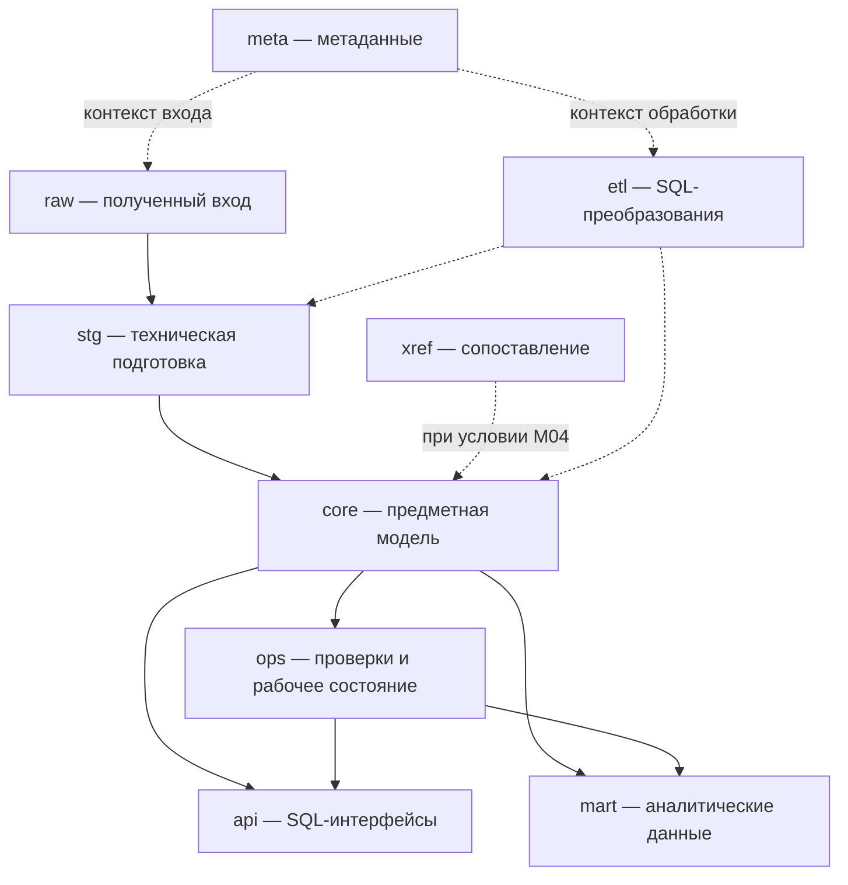

[Главная](../README.md) · [Каноны](README.md)

# Архитектура базы данных DDC

Этот документ устанавливает границы базы данных, назначение схем и правила работы с входными данными. Схема связей приведена в [A03](#a03-схемы-и-зависимости).

Каноны DDC — правила самого проекта. Они не заменяют документацию PostgreSQL.

## Сила нормативных утверждений

Во всех документах канона используются одни и те же обозначения.

| Обозначение | Как читать |
|---|---|
| **Обязательно** | правило должно выполняться |
| **Запрещено** | решение не соответствует канону |
| **Допустимо** | вариант разрешён при выполнении его условий |
| **По умолчанию** | исходный выбор; исключение требует указанного основания |
| **Пример** | пояснение, а не предписание |

Условное правило действует только при указанном условии. Упоминание понятия не означает, что нужна одноимённая таблица или колонка.

Основные термины модели раскрыты в [M01](data-modeling-standard.md#m01-модель-и-зернистость), ключи — в [M02](data-modeling-standard.md#m02-идентичность-и-ключи).

## Порядок проверки решений

Прежде чем менять структуру базы, нужно установить смысл данных. Основания для решения — предметные правила, утверждённые контракты источников, реальные данные, каноны DDC, официальная документация соответствующей версии PostgreSQL и воспроизводимые испытания.

Старые таблицы, имена колонок и прежние решения не доказывают правильность модели.

**Обязательно:** соблюдать последовательность:

1. Установить факт и сформулировать гипотезу.
2. Определить, что могло бы её опровергнуть, и провести проверку.
3. Зафиксировать полученный результат, его ограничения и вывод.
4. Построить реляционную модель, выбрать механизм PostgreSQL и только затем писать DDL.

Пока не установлены смысл строки, её зернистость и идентичность, разрешены только диагностические запросы.

**Обязательно:** перед принятием ключа, связи, зависимости или ограничения искать контрпример. Если источники противоречат друг другу, нельзя скрывать противоречие произвольным выбором значения.

Для существенного решения записывают утверждение, основания, возможное опровержение, проверку, исходный результат, статус и пределы вывода. Когда оснований недостаточно, решение не принимают.

| Статус | Значение |
|---|---|
| `VERIFIED` | доказано в указанной области |
| `MEASURED` | измерено на указанном наборе данных |
| `CONTROLLED PROBE` | механизм проверен в контролируемом опыте |
| `STATIC VERIFIED` | установлено по тексту документа или кода |
| `HYPOTHESIS`, `INFERRED` | предположение или вывод без достаточной проверки |
| `NOT VERIFIED` | не проверено |
| `BLOCKED` | решение нельзя принять без недостающих сведений |
| `CONTRADICTION` | доступные свидетельства противоречат друг другу |

Статус не повышают по правдоподобию. Опыт подтверждает только проверенный случай. Если основание опровергнуто, пересматривают и все зависящие от него решения.

**Обязательно:** для каждого нового сохраняемого объекта указать, какой установленный факт или инвариант без него нельзя представить либо обеспечить. Существование старой таблицы — не основание создавать новую.

## A01. Граница базы данных

**Обязательно:** DDC использует одну логическую базу PostgreSQL. Схемы служат для разделения объектов внутри неё. Различные периоды и наборы данных сами по себе не требуют отдельных логических баз.

**Обязательно:** целостность канонических данных обеспечивает PostgreSQL. Правила приёма и изменения данных должны выполняться при любом разрешённом способе записи — из Excel, другого клиента или серверного кода.

## A02. Поступления и происхождение

Нужно различать сам полученный вход, его обработку и происхождение результата.

| Понятие | Смысл |
|---|---|
| Источник | поставщик сведений с определённой ответственностью |
| Набор данных | данные одного вида внутри источника, с установленной зернистостью записи |
| Поступление | отдельный полученный вход одного набора |
| Обработка | применение правил к полученному входу |
| Технический контракт | состав и исходный формат полей, правила технического приведения |
| Идентификация поступления | способ отличить входы и определить принадлежность записей |
| Техническая трассировка | связь результата с входными записями и преобразованиями |
| Предметное происхождение | предметное основание факта или значения |
| Аудит | сведения об изменениях и тех, кто их выполнил |
| Воспроизводимость | возможность повторно получить результат из сохранённого входа, правил и прочих оснований |

**Обязательно:** если нужна техническая трассировка, заранее определить её глубину: до поступления, отдельной строки или преобразования. Когда результат зависит от нескольких входов, ссылка лишь на одно поступление недостаточна.

**Допустимо:** хранить сведения об источнике и наборе в метаданных или закрепить их за SQL-объектом, если связь однозначна. Из этого не следует необходимость отдельных каталогов, журналов обработок, хешей и служебных колонок в каждой предметной таблице.

**Допустимо:** отделять техническую трассировку от предметных данных. Нужны ли история изменений, аудит и воспроизведение старых результатов, определяет конкретная задача. Предметное происхождение факта описывает сама предметная модель.

## A03. Схемы и зависимости

В DDC предусмотрены девять областей ответственности. Это правила организации проекта, а не требование реляционной теории. Схема может оставаться пустой.

Стрелки обозначают логические зависимости, а не порядок SQL-команд. Пунктир показывает необязательные связи. Для `stg` не требуется отдельное хранение; необходимость `xref` определяется по [M04](data-modeling-standard.md#m04-внешняя-идентичность).

**Обязательно:** каждый объект DDC относится к одной из областей, перечисленных ниже.

| Схема | Ответственность |
|---|---|
| `meta` | технические метаданные, сведения о поступлениях и обработке; не дублирует предметные факты |
| `raw` | полученный вход с адресом каждой записи; не объединяет предметные объекты разных источников |
| `stg` | техническое приведение входа по контракту, без предметных исправлений |
| `xref` | соответствие внешних обозначений ключам объектов `core`, без копирования их атрибутов |
| `core` | предметные сущности, факты и отношения, независимые от формата источников |
| `ops` | проверки, назначения, действия и рабочее состояние, связанные с `core` и `ops` |
| `etl` | процедуры и функции преобразования, без собственных хранимых наборов данных |
| `api` | SQL-интерфейсы с явным контрактом, без самостоятельного предметного состояния |
| `mart` | аналитические представления, расчёты и агрегаты на основе `core`, `ops` и других объектов `mart` |

В `core` предметные ссылки ведут к каноническим объектам. При необходимости можно сохранять технические ссылки на вход по A02. В `xref` учитывают область уникальности внешнего обозначения. Объекты `etl` и `api` обращаются к другим схемам только в пределах своей ответственности. Служебный контекст в `mart` не становится альтернативным предметным фактом.

**Запрещено:** исправлять исходный предметный факт через его аналитическую копию в `mart`.

## A04. RAW и STG

`raw` сохраняет полученный вход, а `stg` приводит его к техническому формату. Выбор предметного объекта и правильного значения происходит за пределами `stg`.

**Обязательно:** каждую запись `raw` можно отличить от других записей того же поступления. Для неё должны однозначно определяться поступление, набор данных и источник.

**Допустимо:** использовать составной адрес или отдельный идентификатор с ограничением уникальности исходного адреса. Например, `(load_id, source_row_number)` подходит лишь там, где номер строки действительно уникален внутри поступления.

**Запрещено:** после фиксации поступления менять его значения, состав строк, их адреса или контекст источника и набора. Фиксация — завершённая запись в БД. Исправленный или дополненный вход сохраняют как новое поступление; для повторной обработки используют уже сохранённый вход.

**Допустимо:** удалить поступление целиком по утверждённому правилу хранения, если это не нарушает нужную прослеживаемость и воспроизводимость. Само требование неизменяемости не устанавливает срок хранения.

**Допустимо:** размещать поступления разных источников в одной таблице, если сохраняются их контекст, адреса строк и различие технических контрактов.

**Обязательно:** в `stg` допустимы лишь преобразования, сохраняющие смысл значения по техническому контракту: например, приведение типов, пустых значений и формата записи. Выбор авторитетного значения, сопоставление предметных объектов и исправление факта к `stg` не относятся.

**Допустимо:** реализовать `stg` таблицей, представлением, материализованным представлением или SQL-выражением без отдельного хранения.

Цепочка `RAW → STG → CORE` показывает границы ответственности, а не обязательные стадии записи. Сопоставление внешних обозначений добавляется лишь при необходимости по M04.

## A05. SQL-интерфейсы и права

Контракт интерфейса определяет параметры операции, типы и смысл результата, допустимые изменения и причины отказа.

**Обязательно:** для каждого объекта `api` явно задан контракт. Новая колонка во внутренней таблице не должна автоматически появляться в публичном результате.

**Допустимо:** читать данные через представления или функции, изменять — через функции, процедуры или изменяемые представления. При этом соблюдаются правила целостности [M06](data-modeling-standard.md#m06-ограничения-целостности) и изменения состояния [M09](data-modeling-standard.md#m09-изменение-состояния).

**Обязательно:** роль, работающая через `api`, получает доступ к данным только через предусмотренные интерфейсы. Аналитическая роль читает предусмотренные объекты `mart`. Ни одна из этих ролей не должна получать права изменять внутренние таблицы или структуру БД в обход своего контракта. Конкретные имена ролей и способы входа не предписаны.

**Обязательно:** для представления проверить, чьи права PostgreSQL использует при чтении исходных таблиц. Если представление скрывает строки, проверить защиту от обхода фильтра. `security_invoker` и `security_barrier` применяются только по установленной потребности. См. [CREATE VIEW](https://www.postgresql.org/docs/18/sql-createview.html).

**Допустимо:** предоставлять доступ к операции через `SECURITY DEFINER`.

**Обязательно:** при `SECURITY DEFINER` ограничить полномочия владельца допустимыми действиями, исключить подмену имён объектов и явно определить, кто может выполнять функцию. Право `PUBLIC EXECUTE` допустимо лишь там, где исполнение разрешено всем.
