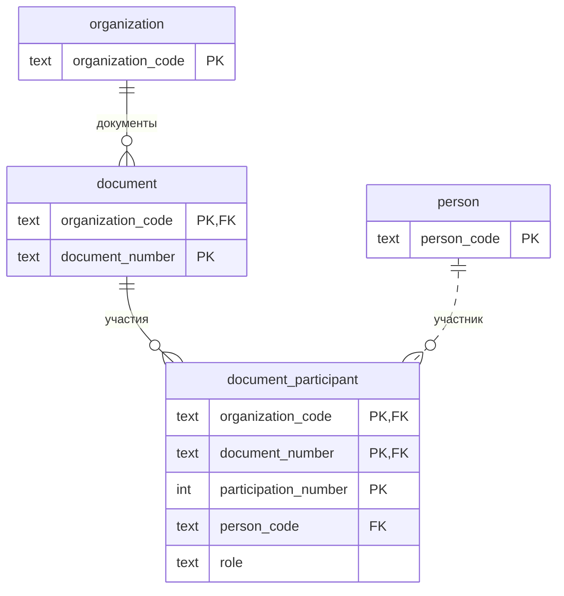

[Главная](../README.md) · [Каноны](README.md)

# Моделирование данных DDC

Этот документ устанавливает правила определения сущностей, фактов, ключей и связей. После построения модели по этим правилам выбирают ограничения PostgreSQL.

Значение нормативных слов приведено в [архитектурном каноне](data-core-architecture-standard.md#сила-нормативных-утверждений). Назначение схем — в [A03](data-core-architecture-standard.md#a03-схемы-и-зависимости).

## M01. Модель и зернистость

Модель описывает, какие факты хранятся, к чему они относятся и какие состояния допустимы.

| Понятие | Смысл |
|---|---|
| Сущность | объект, который остаётся тем же при изменении его свойств |
| Факт | утверждение о событии или состоянии |
| Отношение | участие объектов в определённых ролях |
| Зернистость | что именно представляет одна строка и как различить такие строки |

**Обязательно:** для каждой таблицы и представления определить смысл строки, её зернистость, типы атрибутов и допустимые значения. Для хранимой таблицы также устанавливаются ключи и кратность связей. Нельзя объединять в одной строке независимые факты разной зернистости.

**Обязательно:** до проектирования таблицы ответить на пять вопросов:

1. Что утверждает одна строка?
2. Какова её зернистость?
3. Какой ключ может её однозначно определить?
4. Какова кратность связей с другими данными?
5. Что означает `NULL` в каждом атрибуте, где он допускается?

Для технических данных определяется технический смысл записи. Её адрес не заменяет предметную идентичность.

**Обязательно:** сохраняемый факт или элемент модели должен иметь установленный смысл либо обеспечивать конкретный инвариант. Схема, шаблон или старая таблица сами по себе не требуют создания новых объектов. Для представления не нужен отдельный ID или физический первичный ключ.

**Запрещено:** выводить зернистость и ключи `core` из структуры файлов или прежних таблиц. Пока смысл строки и её идентичность не доказаны, предметную таблицу не проектируют.

## M02. Идентичность и ключи

Идентичность отвечает на вопрос: два сообщения относятся к одному и тому же объекту или к разным?

| Понятие | Смысл |
|---|---|
| Предметная идентичность | правило отнесения наблюдений к одному объекту, факту или участию |
| Предметный ключ | атрибуты, которые различают объекты в установленной области |
| Ключ строки | значения, различающие строки данной зернистости |
| Первичный ключ (`PRIMARY KEY`) | выбранный ключ таблицы, уникальный и без `NULL` |
| Суррогатный ключ | добавленный идентификатор, не выводимый из предметных атрибутов |
| Внутренний идентификатор | обозначение объекта, принятое внутри DDC; не обязательно суррогатное |

**По умолчанию:** хранимая таблица имеет первичный ключ, соответствующий смыслу строки. У полностью воспроизводимого производного представления физического ключа может не быть, если уникальность и зернистость обеспечены его определением, а строки не используются как самостоятельные объекты ссылок.

**Обязательно:** определять полную область уникальности предметного ключа. Если номера независимо выдаются организациями, периодами или подразделениями, соответствующие признаки учитываются в ключе лишь при подтверждённом правиле такой нумерации.

**Допустимо:** использовать естественный или составной первичный ключ. Суррогатный ключ оправдан, если предметный ключ не отвечает требованиям идентичности или связей либо измерено физическое преимущество для данной нагрузки. Сравнивать варианты нужно при равных гарантиях предметной уникальности. Одного удобства недостаточно.

**Обязательно:** при выборе возможного ключа проверять его уникальность, минимальность, отсутствие `NULL`, устойчивость, предметный смысл и область действия. Нужно также выяснить, может ли обозначение позднее перейти к другому объекту.

**Запрещено:** считать ключ доказанным только потому, что в текущей выгрузке не нашлось повторов. Такая проверка устанавливает уникальность лишь для просмотренных данных.

**Обязательно:** если объект узнаётся после смены обозначения, ссылки на него должны сохраняться. Идентификатор нельзя повторно использовать для другого объекта там и тогда, где эти объекты различаются моделью.

**Обязательно:** при введении суррогатного ключа отдельно обеспечить доказанную предметную уникальность. Новый ID не позволяет сам по себе отличить повторную передачу факта от нового факта.

**Запрещено:** заменять неизвестную предметную идентичность номером входной строки, хешем изменяемых атрибутов или придуманным предметным ключом.

**Пример:** если номера документов уникальны только внутри организации, ключ документа — «организация, номер». При добавлении суррогатного идентификатора эта предметная уникальность сохраняется.

## M03. Отношения и структура атрибутов

Связь с другим объектом и самостоятельный факт участия — не одно и то же. Сначала устанавливают смысл и кратность связи, затем решают, как её хранить.

**Обязательно:** простую связь «один ко многим» без собственной зернистости представлять внешним ключом на стороне множества. Ссылка использует установленный ключ целевого объекта.

Если участие имеет собственные атрибуты, историю или допускает повторения, ему нужна отдельная строка установленной зернистости. Отношение «многие ко многим» также представляют отдельной таблицей. Кратность, ограничивающая участие объекта, закрепляется уникальностью.

**Обязательно:** атрибуты самостоятельного участия принадлежат этому участию. Его ключ должен различать повторные случаи, если они допускаются.

**Пример:** документ относится к одной организации — достаточно внешнего ключа в документе. А участие человека в документе имеет роль и номер участия. Оно представлено отдельной таблицей, чтобы один человек мог участвовать несколько раз.

**Запрещено:** разделять связанные части одного факта так, чтобы исчезало соответствие между ними. Нельзя заменять самостоятельные строки и ссылки списками, нумерованными колонками или вложенными значениями, если это скрывает нужную идентичность и ограничения.

**Допустимо:** хранить `JSON` или `ARRAY` как один атрибут, если элементы не нуждаются в собственной идентичности и реляционных ссылках, а ограничения значения обеспечиваются в БД.

**Допустимо:** использовать EAV («объект — атрибут — значение»), когда определения атрибутов сами являются данными предметной области. Их типы, допустимые значения и связи остаются явными.

**Допустимо:** не создавать справочник для обычного скалярного атрибута. Повторение одного значения в разных строках само по себе не делает его отдельной сущностью.

**Обязательно:** проверять предполагаемые функциональные зависимости. Если ожидается `A → B`, нужно искать случаи, когда одному `A` соответствуют разные `B`. Причину выясняют до выбора структуры: неправильный определитель, иная зернистость, версия, независимый факт или противоречие.

**Запрещено:** скрывать нарушение зависимости через `DISTINCT`, `MIN`, `MAX` либо случайный выбор первой или последней строки.

**Обязательно:** если при одном `A` множества `B` и `C` считаются независимыми, проверять это отдельно (`A →→ B` и `A →→ C`). Разделение таблицы не должно терять связи или создавать ложные сочетания. Нормализация выявляет ошибки зависимостей, но не требует создавать таблицы без предметного основания.

## M04. Внешняя идентичность

Один объект может называться по-разному в разных источниках. Отдельная таблица соответствий нужна лишь тогда, когда эти обозначения нельзя однозначно связать по уже хранимым данным.

Полный внешний ключ включает обозначение объекта и область, в которой оно уникально. `xref` хранит соответствие этого ключа выбранному ключу объекта `core`.

**Обязательно:** определить область действия каждого внешнего ключа. Набор данных включается в неё только при независимой нумерации. Если источник переиспользует обозначения, различение по дополнительному признаку или периоду допустимо лишь по его правилу.

**Обязательно:** одно сохраняемое соответствие указывает на существующий объект заданного типа. Полный внешний ключ не может одновременно указывать на разные объекты в одной области действия. Один объект может иметь несколько внешних обозначений.

**Допустимо:** обходиться без `xref`, если внешний ключ уже является ключом объекта или соответствие выводится из существующих данных.

**Обязательно:** хранить соответствие в `xref`, когда его повторное использование необходимо, а восстановить его по текущим ключам и правилам нельзя. Целевой ключ может быть составным; отдельный ID из наличия `xref` не следует.

**Запрещено:** выбирать объект наугад при неоднозначности. Если источник не позволяет узнавать объект между поступлениями, модель не обещает этого.

**Обязательно:** изменение соответствия не исправляет автоматически связанные предметные факты. Для этого требуется правило изменения состояния по [M09](#m09-изменение-состояния).

## M05. Значения, единицы и время

Значение `NULL` означает отсутствие значения в смысле конкретного атрибута. Причину отсутствия необходимо определить: неизвестно, не применяется или не получено.

**Обязательно:** установить, где допустим `NULL` и что он означает. Если разные причины отсутствия важны для модели, их нужно различать в данных.

**Запрещено:** заменять `NULL` нулём, пустой строкой, признаком ошибки или статусом. Ноль и пустая строка — самостоятельные значения, если так определено моделью.

**Пример:** расход топлива `0` литров означает известный нулевой расход. `NULL` может означать, что расход неизвестен.

**Обязательно:** для каждой величины определить её смысл и единицу измерения. Постоянную единицу достаточно закрепить в описании атрибута. Переменная должна следовать из записи или её однозначного контекста. Масштаб и точность задаются там, где это требуется контрактом или корректностью значения. Отдельная колонка с единицей нужна не всегда.

**Обязательно:** для временного атрибута вне исходного `raw` определить, что он обозначает: дату, время суток, местное время, абсолютный момент или период. Выбрать соответствующий тип PostgreSQL: `date`, `time`, `timestamp without time zone`, `timestamptz` или представление периода.

**Обязательно:** вход, обозначающий абсолютный момент, должен однозначно определять этот момент. Местному времени часовой пояс требуется при переводе в абсолютный момент. `timestamptz` не сохраняет название исходного часового пояса; хранить его отдельно нужно только при самостоятельном смысле.

**Обязательно:** не подменять время события временем получения или сохранения записи. Время операции БД вычисляется средствами БД по установленному правилу. Один временной атрибут не требует обязательного создания других.

## M06. Ограничения целостности

Целостность проверяется в БД, чтобы результат не зависел от пути записи. Таблица ниже связывает инварианты модели с механизмами PostgreSQL.

**Обязательно:** заявленные уникальность, обязательность, допустимые значения и ссылки на хранимые объекты обеспечиваются средствами PostgreSQL на всех разрешённых путях изменения данных.

| Инвариант | Средство PostgreSQL |
|---|---|
| ключ строки таблицы | PK по M02 |
| дополнительная предметная уникальность | `UNIQUE` или уникальный индекс с областью, соответствующей модели |
| ссылка на ключ хранимого объекта | `FOREIGN KEY (FK)` |
| обязательное значение | `NOT NULL` |
| условие над значениями одной строки | `CHECK`, тип или домен |
| запрещённое сочетание значений разных строк | ограничение исключения либо другое средство, обеспечивающее заявленный инвариант |

**Обязательно:** условия проверок учитывают семантику `NULL`. Обычный `UNIQUE` не запрещает все повторы с `NULL`; `CHECK`, возвращающий `NULL`, не отклоняет строку. Для составной FK допустимость частично пустой ссылки задаётся моделью.

**Обязательно:** проверять, действует ли ограничение на нужные строки. В PostgreSQL 18 наличие `CHECK` или внешнего ключа ещё не доказывает их применение: учитывать `NOT ENFORCED`, `NOT VALID` и признаки `pg_constraint.conenforced`, `convalidated`. См. [ограничения таблиц](https://www.postgresql.org/docs/18/sql-createtable.html) и [каталог ограничений](https://www.postgresql.org/docs/18/catalog-pg-constraint.html).

**Запрещено:** использовать `CHECK` с чтением других строк как гарантию межстрочного или межтабличного инварианта.

**Допустимо:** серверный SQL-механизм для условия, не выражаемого декларативным ограничением, если он сохраняет это условие и при конкурентных изменениях. Поведение FK при изменении и удалении целевого ключа соответствует смыслу зависимости; общий `CASCADE` из наличия связи не следует.

**Запрещено:** создавать фиктивный предметный объект только для прохождения обязательной FK. Неразрешённая обязательная ссылка не является допустимым принятым фактом.

## M07. История и периоды

История состояния — данные о разных состояниях одного объекта или отношения. Версия — отдельно различаемое сохранённое состояние этого объекта или отношения.

**По умолчанию:** модель хранит текущее состояние. История обязательна, если заявленный смысл данных требует получать состояние на прошлую дату либо сохранять состояние, на которое ссылается существующий факт, а замена значения это состояние теряет.

**Запрещено:** из самой возможности изменения атрибута выводить требование версии, `is_current`, хеша состояния, исторической таблицы или колонок периода.

**Обязательно:** если хранятся версии объекта, идентичность объекта и идентичность версии различаются. Способ представления версии определяется её зернистостью, без автоматического добавления суррогатного идентификатора.

**Обязательно:** для хранимого периода определены смысл начала и конца, включённость границ и смысл открытой границы. При ограниченных границах начало не позже конца; допустимость пустого периода определена моделью. Если предметный смысл допускает только одно значение в момент времени, пересекающиеся периоды этого значения запрещены и ограничены в БД.

**Допустимо:** полуоткрытая форма `[from, to)` или другая явно определённая форма границ. Время поступления не определяет период предметного действия.

**Допустимо:** для доказанных временных ограничений использовать `WITHOUT OVERLAPS` и `FOREIGN KEY ... PERIOD` в PostgreSQL 18. Эти механизмы не требуют вводить историю там, где она не нужна. См. [CREATE TABLE](https://www.postgresql.org/docs/18/sql-createtable.html).

**Обязательно:** исторический результат использует прошлый предметный контекст только там, где этот контекст представлен первичными данными; текущее значение само по себе не доказывает прошлое.

## M08. Производные данные и агрегаты

Производное значение однозначно вычисляется из других данных по заданному правилу. Значение, в том числе зафиксированное источником, является фактом, если оно представляет самостоятельное предметное утверждение о событии или состоянии, даже при наличии сходного расчёта. Этот смысл задаётся предметной моделью; наличие входного поля само по себе не делает значение самостоятельным фактом.

**По умолчанию:** производное значение вычисляется. Его хранение допустимо для заявленного требования к доступу или вычислению, если определены исходные данные, правило и сохранение соответствия между ними и результатом. Для сохранённого среза или кэша определены срез исходных данных и условие его применимости.

**Запрещено:** выдавать изменяемую копию производного значения за независимый первичный факт.

**Обязательно:** SQL-показатель определяет состав учитываемых фактов, правило расчёта и смысл результата. Соединение и агрегация сохраняют заявленное правило учёта: вклад исходного факта не увеличивается из-за независимой кратности соединённых отношений.

**Запрещено:** считать совпадение отображаемых названий достаточным доказательством тождества соединяемых объектов.

**По умолчанию:** вычисляемые данные получать запросом или представлением (`VIEW`). Хранить их отдельно только при установленной необходимости.

## M09. Изменение состояния

Входной контракт описывает смысл получаемых записей и их влияние на модель. Снимок состояния (`snapshot`) содержит сведения за объявленную область полноты; набор изменений (`delta`) сообщает об отдельных изменениях. Полнота всегда относится к определённому набору объектов или фактов.

**Обязательно:** контракт определяет зернистость и идентичность записи, вид поставки, границы её полноты и смысл отсутствия. Если источник исправляет сведения, устанавливается способ исправления. Для противоречащих сообщений требуется правило разрешения конфликта. Время получения не означает приоритет.

**Обязательно:** для снимка состояния отдельно проверить область и полноту, порядок состояний (если важен), смысл отсутствия записи, исправлений и повторов. Имя файла, время его изменения, момент получения и порядок обработки не определяют предметный порядок.

**Запрещено:** считать отсутствие записи удалением в наборе изменений или неполном снимке. Даже в полном снимке удаление следует из отсутствия только при явном правиле источника и внутри объявленной области.

**Пример:** в полном реестре действующих документов отсутствие документа может означать удаление, если это оговорено контрактом. В наборе изменений такого вывода нет.

**Обязательно:** повтор того же входа при тех же правилах, сопоставлениях и предметном контексте не создаёт дополнительные предметные факты. Идентичные значения разных событий не являются доказанным повтором.

**Обязательно:** конфликт нескольких источников либо разрешается правилом, однозначно выбирающим каноническое значение, либо остаётся неразрешённым и спорное значение не принимается как каноническое. Разрешение идентичности объекта не разрешает конфликт значений; случайный порядок выполнения SQL или ETL не разрешает предметный конфликт.

**Пример:** два источника сообщили разные адреса одного объекта. Если контракт назначает одному источнику приоритет для адреса, правило выбирает его значение. Если правило не выбирает адрес однозначно, спорное значение не принимается как каноническое.

**Допустимо:** исправление текущего состояния обновлением или удалением, если модель по M07 не сохраняет потерянное прошлое состояние. Для модели с требуемой историей исправление сохраняет смысл ранее зафиксированных фактов и их ссылок.

**Обязательно:** модель определяет единицу неделимого изменения. Все связанные изменения этой единицы фиксируются одной транзакцией; ошибка не публикует её частично допустимое состояние. Объявленная уникальность и кратность сохраняются при конкурирующих изменениях.

**Обязательно:** перед усилением изоляции или введением блокировок показать, как две конкурирующие транзакции (`T1` и `T2`) могут сохранить недопустимое состояние. Проверить сценарий. Без такого основания дополнительная блокировка не обоснована. Фиктивный `UPDATE x = x` для захвата блокировки не применять.

**Обязательно:** результат, относящийся к определённым данным объекта, имеет определённое моделью отношение к их изменению: сохраняет ссылку на те данные либо перестаёт утверждать результат для изменённого состояния. Это условие само по себе не требует общей версии или статуса для всех объектов.

## M10. Выбор средств PostgreSQL

**Обязательно:** после доказательства модели выбрать самый простой механизм, способный обеспечить нужное правило. Проверять по порядку: тип → `NOT NULL` → `PRIMARY KEY` / `UNIQUE` → `FOREIGN KEY` → `CHECK` → `EXCLUDE` → представление или запрос → транзакция → изоляция и блокировки → функция или процедура → триггер. Это порядок выбора, а не перечень обязательных объектов.

**По умолчанию:** не создавать без обоснования триггеры, временные таблицы, материализованные представления, партиции, RLS, специальные блокировки, `SERIALIZABLE`, `SECURITY DEFINER`, собственные разборщики входа, универсальные структуры JSONB или EAV, общий механизм версий и историю изменений. То же относится к служебным полям `state_hash`, `is_current`, `valid_from`, `valid_to` и к хранению событий вместо текущих фактов.

**Обязательно:** дополнительный индекс создавать для обеспечения уникальности или установленной нагрузки соединений, отбора, сортировки и проверок внешних ключей. Индекс ради ускорения требует измерения до и после.

**Обязательно:** сначала подтвердить правильность модели и ограничений, затем изучить реальную нагрузку, найти причину затрат через `EXPLAIN (ANALYZE, BUFFERS, WAL)` там, где это применимо, внести минимальное изменение и повторить замеры. Учитывать, что `EXPLAIN ANALYZE` выполняет запрос. См. [документацию EXPLAIN](https://www.postgresql.org/docs/18/sql-explain.html).

**Обязательно:** для результатов испытания указывать версию PostgreSQL, данные и сценарий проверки, фактический результат и пределы вывода. Синтетический тест доказывает поведение механизма, но не правильность предметной модели.
