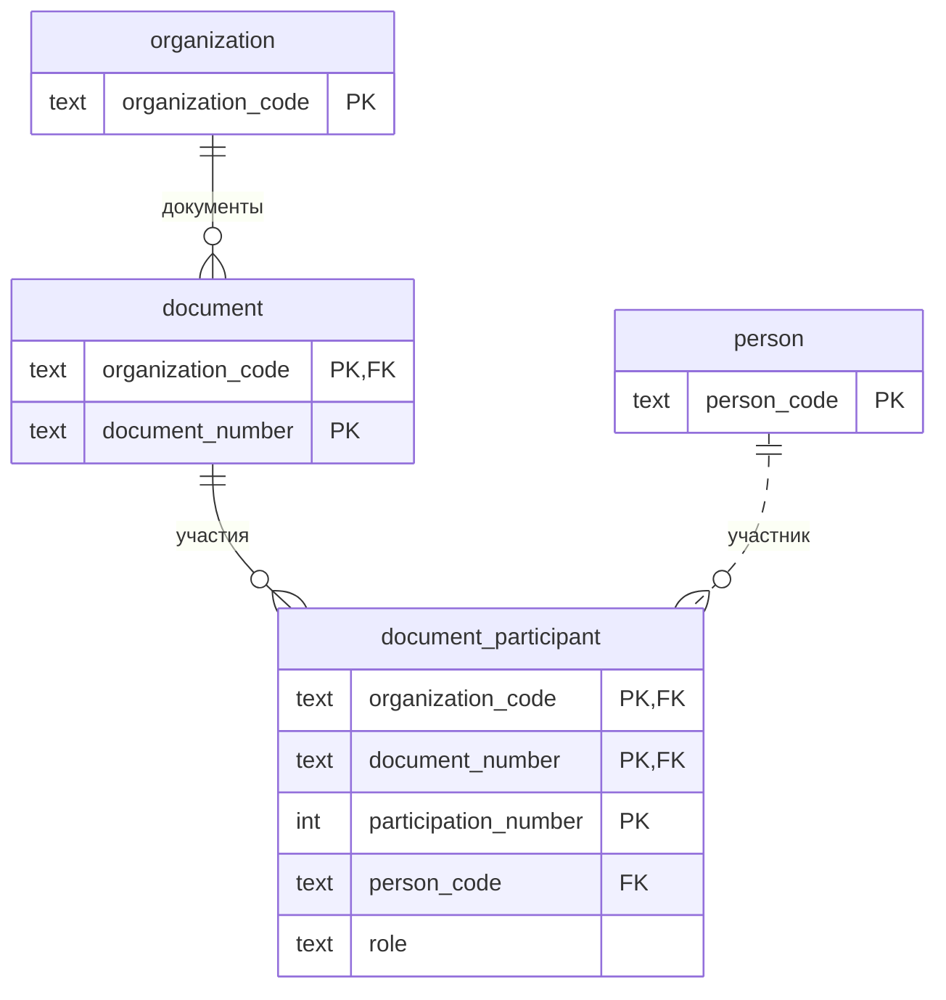

[Главная](../README.md) · [Каноны](README.md)

# Моделирование данных DDC

Этот документ устанавливает правила определения сущностей, фактов, ключей и связей. После построения модели по этим правилам выбирают ограничения PostgreSQL.

Порядок применения показан в [учебном примере](practical-modeling-example.md). Он не устанавливает предметных фактов для реальных источников.

Значение нормативных слов приведено в [архитектурном каноне](data-core-architecture-standard.md#сила-нормативных-утверждений). Назначение схем — в [A03](data-core-architecture-standard.md#a03-схемы-и-зависимости).

## M01. Модель и зернистость

Модель описывает, какие факты хранятся, к чему они относятся и какие состояния допустимы.

| Понятие | Смысл |
|---|---|
| Сущность | объект, который остаётся тем же при изменении его свойств |
| Факт | утверждение о событии или состоянии |
| Отношение | участие объектов в определённых ролях |
| Зернистость | что именно представляет одна строка и как различить такие строки |

**Обязательно:** для каждой таблицы и представления определить смысл строки, её зернистость, типы атрибутов и допустимые значения. Для хранимой таблицы также устанавливаются ключи и кратность связей. Нельзя объединять в одной строке независимые факты разной зернистости.

**Обязательно:** до проектирования таблицы ответить на пять вопросов:

1. Что утверждает одна строка?
2. Какова её зернистость?
3. Какой ключ может её однозначно определить?
4. Какова кратность связей с другими данными?
5. Что означает `NULL` в каждом атрибуте, где он допускается?

Для технических данных определяется технический смысл записи. Её адрес не заменяет предметную идентичность.

**Обязательно:** сохраняемый факт или элемент модели должен иметь установленный смысл либо обеспечивать конкретный инвариант. Схема, шаблон или старая таблица сами по себе не требуют создания новых объектов. Для представления не нужен отдельный ID или физический первичный ключ.

**Запрещено:** выводить зернистость и ключи `core` из структуры файлов или прежних таблиц. Пока смысл строки и её идентичность не доказаны, предметную таблицу не проектируют.

## M02. Идентичность и ключи

Идентичность отвечает на вопрос: два сообщения относятся к одному и тому же объекту или к разным?

| Понятие | Смысл |
|---|---|
| Предметная идентичность | правило отнесения наблюдений к одному объекту, факту или участию |
| Предметный ключ | атрибуты, которые различают объекты в установленной области |
| Ключ строки | значения, различающие строки данной зернистости |
| Первичный ключ (`PRIMARY KEY`) | выбранный ключ таблицы, уникальный и без `NULL` |
| Суррогатный ключ | добавленный идентификатор, не выводимый из предметных атрибутов |
| Внутренний идентификатор | обозначение объекта, принятое внутри DDC; не обязательно суррогатное |

**По умолчанию:** хранимая таблица имеет первичный ключ, соответствующий смыслу строки. У полностью воспроизводимого производного представления физического ключа может не быть, если уникальность и зернистость обеспечены его определением, а строки не используются как самостоятельные объекты ссылок.

**Обязательно:** определять полную область уникальности предметного ключа. Если номера независимо выдаются организациями, периодами или подразделениями, соответствующие признаки учитываются в ключе лишь при подтверждённом правиле такой нумерации.

**Допустимо:** использовать естественный или составной первичный ключ. Суррогатный ключ оправдан, если предметный ключ не отвечает требованиям идентичности или связей либо измерено физическое преимущество для данной нагрузки. Сравнивать варианты нужно при равных гарантиях предметной уникальности. Одного удобства недостаточно.

**Обязательно:** при выборе возможного ключа проверять его уникальность, минимальность, отсутствие `NULL`, устойчивость, предметный смысл и область действия. Нужно также выяснить, может ли обозначение позднее перейти к другому объекту.

**Запрещено:** считать ключ доказанным только потому, что в текущей выгрузке не нашлось повторов. Такая проверка устанавливает уникальность лишь для просмотренных данных.

**Обязательно:** если объект узнаётся после смены обозначения, ссылки на него должны сохраняться. Идентификатор нельзя повторно использовать для другого объекта там и тогда, где эти объекты различаются моделью.

**Обязательно:** при введении суррогатного ключа отдельно обеспечить доказанную предметную уникальность. Новый ID не позволяет сам по себе отличить повторную передачу факта от нового факта.

**Запрещено:** заменять неизвестную предметную идентичность номером входной строки, хешем изменяемых атрибутов или придуманным предметным ключом.

**Пример:** если номера документов уникальны только внутри организации, ключ документа — «организация, номер». При добавлении суррогатного идентификатора эта предметная уникальность сохраняется.

Как проверить кандидаты на ключ диагностическими запросами, показано в [учебном примере, раздел 8](practical-modeling-example.md#8-диагностические-запросы-проверяем-гипотезы).

## M03. Отношения и структура атрибутов

Связь с другим объектом и самостоятельный факт участия — не одно и то же. Сначала устанавливают смысл и кратность связи, затем решают, как её хранить.

**Обязательно:** простую связь «один ко многим» без собственной зернистости представлять внешним ключом на стороне множества. Ссылка использует установленный ключ целевого объекта.

Если участие имеет собственные атрибуты, историю или допускает повторения, ему нужна отдельная строка установленной зернистости. Отношение «многие ко многим» также представляют отдельной таблицей. Кратность, ограничивающая участие объекта, закрепляется уникальностью.

**Обязательно:** атрибуты самостоятельного участия принадлежат этому участию. Его ключ должен различать повторные случаи, если они допускаются.

**Пример:** документ относится к одной организации — достаточно внешнего ключа в документе. А участие человека в документе имеет роль и номер участия. Оно представлено отдельной таблицей, чтобы один человек мог участвовать несколько раз.

**Запрещено:** разделять связанные части одного факта так, чтобы исчезало соответствие между ними. Нельзя заменять самостоятельные строки и ссылки списками, нумерованными колонками или вложенными значениями, если это скрывает нужную идентичность и ограничения.

**Допустимо:** хранить `JSON` или `ARRAY` как один атрибут, если элементы не нуждаются в собственной идентичности и реляционных ссылках, а ограничения значения обеспечиваются в БД.

**Допустимо:** использовать EAV («объект — атрибут — значение»), когда определения атрибутов сами являются данными предметной области. Их типы, допустимые значения и связи остаются явными.

**Допустимо:** не создавать справочник для обычного скалярного атрибута. Повторение одного значения в разных строках само по себе не делает его отдельной сущностью.

**Обязательно:** проверять предполагаемые функциональные зависимости. Если ожидается `A → B`, нужно искать случаи, когда одному `A` соответствуют разные `B`. Причину выясняют до выбора структуры: неправильный определитель, иная зернистость, версия, независимый факт или противоречие.

**Запрещено:** скрывать нарушение зависимости через `DISTINCT`, `MIN`, `MAX` либо случайный выбор первой или последней строки.

**Обязательно:** если при одном `A` множества `B` и `C` считаются независимыми, проверять это отдельно (`A →→ B` и `A →→ C`). Разделение таблицы не должно терять связи или создавать ложные сочетания. Нормализация выявляет ошибки зависимостей, но не требует создавать таблицы без предметного основания.

Пример проверки потерь при декомпозиции — в [разделе 9 учебного разбора](practical-modeling-example.md#9-декомпозиция-как-возникают-ложные-сочетания).

## M04. Внешняя идентичность

Один объект может называться по-разному в разных источниках. Отдельная таблица соответствий нужна лишь тогда, когда эти обозначения нельзя однозначно связать по уже хранимым данным.

Полный внешний ключ включает обозначение объекта и область, в которой оно уникально. `xref` хранит соответствие этого ключа выбранному ключу объекта `core`.

**Обязательно:** определить область действия каждого внешнего ключа. Набор данных включается в неё только при независимой нумерации. Если источник переиспользует обозначения, различение по дополнительному признаку или периоду допустимо лишь по его правилу.

**Обязательно:** одно сохраняемое соответствие указывает на существующий объект заданного типа. Полный внешний ключ не может одновременно указывать на разные объекты в одной области действия. Один объект может иметь несколько внешних обозначений.

**Допустимо:** обходиться без `xref`, если внешний ключ уже является ключом объекта или соответствие выводится из существующих данных.

**Обязательно:** хранить соответствие в `xref`, когда его повторное использование необходимо, а восстановить его по текущим ключам и правилам нельзя. Целевой ключ может быть составным; отдельный ID из наличия `xref` не следует.

**Запрещено:** выбирать объект наугад при неоднозначности. Если источник не позволяет узнавать объект между поступлениями, модель не обещает этого.

**Обязательно:** изменение соответствия не исправляет автоматически связанные предметные факты. Для этого требуется правило изменения состояния по [M09](#m09-изменение-состояния).

## M05. Значения, единицы и время

Значение `NULL` означает отсутствие значения в смысле конкретного атрибута. Причину отсутствия необходимо определить: неизвестно, не применяется или не получено.

**Обязательно:** установить, где допустим `NULL` и что он означает. Если разные причины отсутствия важны для модели, их нужно различать в данных.

**Запрещено:** заменять `NULL` нулём, пустой строкой, признаком ошибки или статусом. Ноль и пустая строка — самостоятельные значения, если так определено моделью.

**Пример:** расход топлива `0` литров означает известный нулевой расход. `NULL` может означать, что расход неизвестен.

**Обязательно:** у каждой величины должны быть установлены смысл и единица измерения. Если единица постоянна, достаточно указать её в определении атрибута. Если меняется, она должна определяться по строке или её однозначному контексту.

Масштаб и точность задают по контракту и требованиям корректности. Отдельная колонка с единицей нужна не всегда.

**Обязательно:** для временного атрибута вне исходного `raw` определить, что он обозначает: дату, время суток, местное время, абсолютный момент или период. Выбрать соответствующий тип PostgreSQL: `date`, `time`, `timestamp without time zone`, `timestamptz` или представление периода.

**Обязательно:** вход, обозначающий абсолютный момент, должен однозначно определять этот момент. Местному времени часовой пояс требуется при переводе в абсолютный момент. `timestamptz` не сохраняет название исходного часового пояса; хранить его отдельно нужно только при самостоятельном смысле.

**Обязательно:** не подменять время события временем получения или сохранения записи. Время операции БД вычисляется средствами БД по установленному правилу. Один временной атрибут не требует обязательного создания других.

## M06. Ограничения целостности

Ограничения должны действовать в PostgreSQL независимо от того, каким клиентом записывают данные.

**Обязательно:** обеспечивать в БД установленные ключи, обязательность значений, допустимые состояния и ссылки на другие объекты.

| Что требуется | Средство PostgreSQL |
|---|---|
| Первичный ключ | `PRIMARY KEY` |
| Дополнительная уникальность | `UNIQUE` или подходящий уникальный индекс |
| Ссылка на существующий объект | `FOREIGN KEY` |
| Обязательное значение | `NOT NULL` |
| Проверка одной строки | Тип, домен или `CHECK` |
| Запрет отдельных сочетаний строк | `EXCLUDE` или другой механизм, обеспечивающий инвариант |

**Обязательно:** учитывать поведение `NULL`. Обычное `UNIQUE` не запрещает все повторы с `NULL`, а `CHECK` пропускает неопределённый результат. Для составного внешнего ключа нужно определить, допускается ли частично пустая ссылка.

**Обязательно:** проверять, действует ли ограничение на нужные строки. В PostgreSQL 18 учитывают `NOT ENFORCED`, `NOT VALID` и признаки каталога `pg_constraint` — `conenforced` и `convalidated`, когда они применимы.

См. [CREATE TABLE](https://www.postgresql.org/docs/18/sql-createtable.html) и [pg_constraint](https://www.postgresql.org/docs/18/catalog-pg-constraint.html).

**Запрещено:** считать `CHECK`, читающий другие строки, надёжной гарантией межстрочного или межтабличного правила.

**Допустимо:** применять серверный SQL-механизм, если инвариант нельзя выразить декларативным ограничением. Он должен сохранять целостность и при конкурентных изменениях. Действия внешнего ключа при изменении и удалении определяются смыслом связи; `CASCADE` не назначают автоматически.

**Запрещено:** создавать фиктивный предметный объект только ради прохождения внешнего ключа. Неразрешённая обязательная ссылка не должна попадать в принятые факты.

## M07. История и периоды

История хранит прошлые состояния, а версия обозначает одно отдельно сохранённое состояние объекта или отношения.

**По умолчанию:** хранить текущее состояние. История необходима, когда нужно восстановить прошлое состояние или сохранить состояние, на которое ссылается другой факт и которое потерялось бы при замене значения.

**Запрещено:** вводить историю, версии, `is_current`, хеш состояния или колонки периода только потому, что атрибут может меняться.

**Обязательно:** при хранении версий различать идентичность объекта и каждой версии. Отдельный суррогатный ID не обязателен: ключ определяется зернистостью версии.

**Обязательно:** у каждого периода определить смысл начала и конца, включённость и возможность открытой границы. Начало не может быть позже конца; допустимость пустого периода задаётся моделью. Если в один момент допустимо только одно значение, пересечение периодов должно запрещаться ограничением БД.

**Допустимо:** применять полуоткрытый период `[from, to)` или другую установленную форму. Время получения данных не определяет период действия факта.

**Допустимо:** для подходящих временных ограничений в PostgreSQL 18 использовать `WITHOUT OVERLAPS` и `FOREIGN KEY ... PERIOD`. Само наличие этих механизмов не требует истории. См. [CREATE TABLE](https://www.postgresql.org/docs/18/sql-createtable.html).

**Обязательно:** исторический расчёт использует прошлый предметный контекст лишь тогда, когда он действительно сохранён. Из текущего значения нельзя выводить прошлое без дополнительного основания.

## M08. Производные данные и агрегаты

Производное значение можно однозначно вычислить из других данных по известному правилу. Отдельный факт — это самостоятельное предметное утверждение о событии или состоянии. Даже если источник передал готовое число, оно не становится отдельным фактом без такого смысла.

**По умолчанию:** производные значения вычисляют, а не хранят отдельно. Если хранение необходимо, определяют исходные данные, способ расчёта и сохранение соответствия между ними и результатом.

Для сохранённого среза или кэша также указывают, по каким исходным данным он построен и когда применим.

**Запрещено:** выдавать изменяемую копию рассчитанного значения за независимый первичный факт.

**Обязательно:** для каждого показателя определить, какие факты учитываются и как считается результат. Соединения и агрегаты не должны увеличивать вклад факта из-за независимого множества связанных строк.

**Запрещено:** соединять объекты только потому, что их отображаемые названия совпадают.

**По умолчанию:** получать вычисляемые данные запросом или представлением (`VIEW`). Для отдельного хранения требуется обоснование.

## M09. Изменение состояния

Входной контракт описывает смысл полученных записей и то, как они влияют на модель.

Снимок (`snapshot`) сообщает состояние в объявленной области полноты. Набор изменений (`delta`) сообщает об отдельных изменениях. Это разные виды входа, и отсутствие записи в них может иметь разный смысл.

**Обязательно:** для каждого входа установить зернистость и способ различения записей. Если вход описывает состояние, определить вид поставки и область её полноты.

**Обязательно:** отдельно определить, что означает отсутствие записи, как передаются исправления и повторы. Если несколько источников претендуют на одно каноническое значение, заранее установить правило разрешения конфликта. Момент получения данных не определяет приоритет без явного контракта.

**Обязательно:** для снимка проверить заявленную и фактическую полноту. Когда порядок состояний важен, его задаёт предметный контракт, а не имя файла, время изменения, поступления или очередность обработки.

**Запрещено:** считать отсутствие записи удалением в наборе изменений или неполном снимке. В полном снимке это допустимо лишь по явному правилу и внутри области полноты.

**Пример:** отсутствие документа в полном реестре действующих документов может означать его удаление, если так определено контрактом. В наборе отдельных изменений отсутствие ничего не сообщает об удалении.

**Обязательно:** повторная передача того же входа при тех же правилах, сопоставлениях и предметном контексте не должна создавать новый факт. Но совпадение значений двух событий само по себе не делает одно событие повтором другого.

**Обязательно:** конфликт между источниками разрешать по установленному правилу. Если правило не позволяет выбрать значение, спорное значение не принимается как каноническое. Установленная идентичность объекта ещё не решает конфликт его атрибутов.

**Пример:** два источника передали разные адреса объекта. Выбор допустим при установленном приоритете источника для этого атрибута. Без такого правила нельзя брать последний полученный адрес.

**Допустимо:** исправлять текущее состояние обновлением или удалением, если модель не требует сохранять прошлое по M07. Когда история необходима, исправление не должно уничтожать смысл сохранённых фактов и ссылок.

**Обязательно:** установить, какие изменения должны быть неделимы. Их выполняют одной транзакцией: ошибка не должна оставлять частично принятое состояние. Ключи и кратности должны соблюдаться и при конкурентной записи.

**Обязательно:** перед введением дополнительной блокировки или усилением изоляции показать, как две транзакции (`T1` и `T2`) могут сохранить недопустимое состояние, и воспроизвести этот сценарий. Без проверенного основания дополнительная синхронизация не обоснована. Фиктивный `UPDATE x = x` ради блокировки не применять.

Порядок двухсеансовой проверки с явно отделёнными ожидаемыми и фактическими результатами приведён в [разделе 10 учебного разбора](practical-modeling-example.md#10-отдельный-технический-опыт-конкурентная-запись-t1t2).

**Обязательно:** если результат проверки относится к определённому состоянию объекта, при изменении этого состояния он либо сохраняет ссылку на проверенные данные, либо перестаёт считаться проверкой нового состояния. Общий механизм версий из этого не следует.

## M10. Выбор средств PostgreSQL

Сначала определяют правило целостности, затем подбирают средство, которое его обеспечивает. Более сложный механизм не нужен, если достаточно простого.

**Обязательно:** рассматривать применимые средства в порядке:

1. Тип данных и `NOT NULL`.
2. `PRIMARY KEY`, `UNIQUE`, `FOREIGN KEY`, `CHECK`, `EXCLUDE`.
3. Представление или запрос, затем транзакция.
4. Изоляция и блокировки.
5. Функция, процедура или триггер.

Этот порядок не обязывает создавать все перечисленные объекты. Временные ограничения по M07 также рассматриваются там, где они применимы.

**По умолчанию:** не применять без отдельного основания триггеры, временные таблицы, материализованные представления, партиции, RLS, дополнительные блокировки, `SERIALIZABLE`, `SECURITY DEFINER` и собственные разборщики файлов.

То же относится к универсальным моделям JSONB/EAV, общим механизмам истории и версий, хранению событий вместо текущего состояния и служебным полям `state_hash`, `is_current`, `valid_from`, `valid_to`.

**Обязательно:** создавать дополнительный индекс для предметной уникальности или доказанной нагрузки на соединение, отбор, сортировку и проверки внешних ключей. Эффект индекса для ускорения подтверждается измерением до и после.

**Обязательно:** оптимизировать SQL только после проверки модели, ограничений и транзакций. Сначала измеряют реальную нагрузку и выявляют причину затрат. Затем вносят минимальное изменение и повторяют замеры.

Для анализа можно использовать `EXPLAIN (ANALYZE, BUFFERS, WAL)`, когда он применим. Помните: `EXPLAIN ANALYZE` выполняет запрос. См. [документацию](https://www.postgresql.org/docs/18/sql-explain.html).

**Обязательно:** в отчёте об испытании указывать версию PostgreSQL, проверенные данные и сценарий, фактический результат и границы вывода. Синтетический тест подтверждает работу механизма, но не правильность предметной модели.
